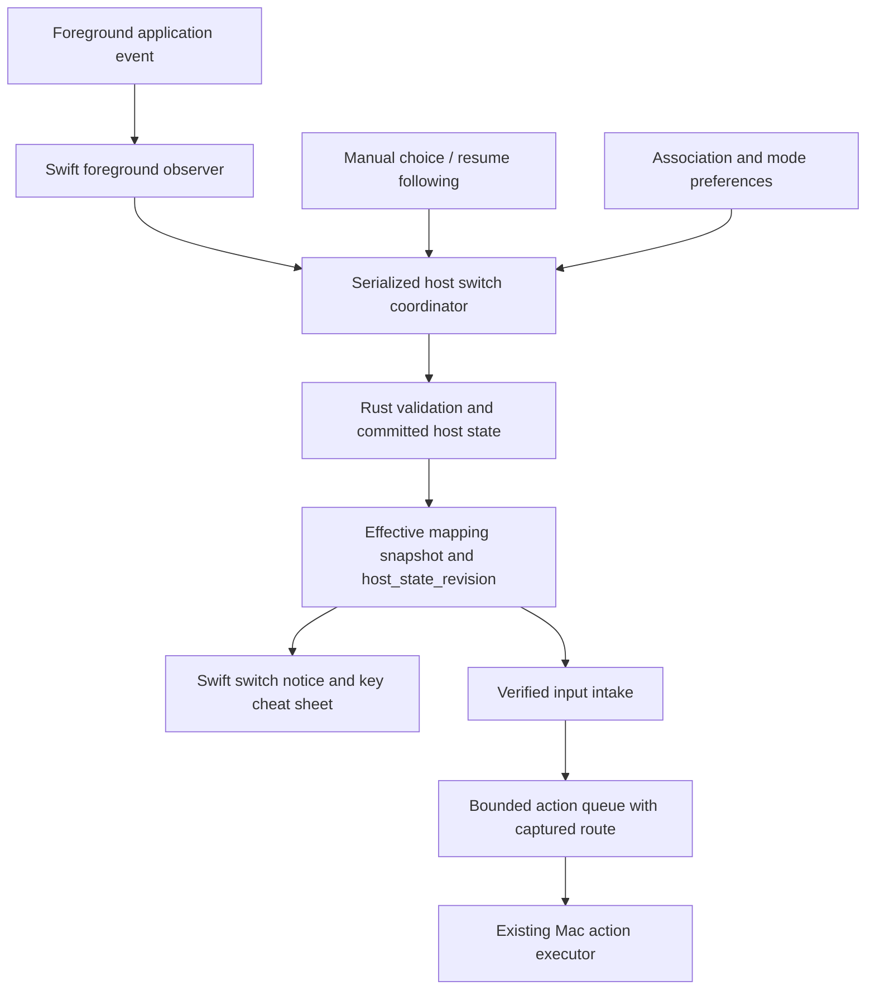

# Micro Input: App Following, Switch Notice, and Key Cheat Sheet

* **Author:** semantic-craft
* **Status:** Host following, switch notice, and passive cheat sheet implemented in PR #54. Physical input, full-screen Space, and installed-app acceptance remain open.
* **Date:** 2026-11-03
* **Project:** Micro Input
* **Approval:** All design sections and this destination approved by the author on 2026-11-03. Implementation evidence is recorded in PR #54 and docs/verification/app-following-and-hud.md.

## Overview

Let the user opt into following the foreground app with a linked host Profile. Show a brief notice when the active Profile changes, and let the user open a key cheat sheet for the Profile that actually controls host actions. Keep the existing manual Profile selection available.

The author-approved scope is: an app with no association keeps the previous Profile; a manual selection stays in effect; the first increment includes automatic following, switch notices, and a key cheat sheet. An interactive radial menu is deferred.

Following is off by default. A manual Profile selection overrides following until the user explicitly resumes it, including across app changes and Micro Input restarts. Keeping a Profile when an unlinked app becomes foreground does not itself create a manual override: a later linked app can still trigger following.

This increment changes host routing on the Mac. It does not write or activate a device configuration. It is part of S5, not delivery of the whole S5 stage.

## The Problem

The user currently switches host Profiles from the menu bar. Moving between Antigravity, DeepSeek Harness, and Herdr requires a second manual step before the controller uses the desired mapping. The user also needs to see which Profile is active and recall what each physical key does without inspecting the editor.

Automatic following creates a competing problem: it can undo an intentional manual choice. Keeping the last Profile in an unlinked app also means that the controller can still target the previous work app. The user has chosen that behavior. The interface must make the actual control target and manual override visible so this retained routing is understandable.

A cheat sheet can be misleading if it shows the Profile being edited instead of the one used for execution. A switch notice can also lie if it appears before switching succeeds. Both displays must describe actual host routing and distinguish a selected Profile from whether host execution is available.

## Goals

1. Provide an explicit opt-in to automatic following and a visible indication of its state. Only an explicitly associated app may select its linked host Profile.
2. Keep the current Profile when the foreground app has no association. Do not pause actions or select a generic fallback merely because the app is unlinked.
3. Keep a manual selection until the user chooses to resume following. Persist this override across restart. Foreground events must not undo it.
4. Show a brief, non-focus-stealing notice after an actual successful Profile change. Do not report a switch for an unlinked app, a repeated match to the same Profile, or a failed change.
5. Provide an on-demand key cheat sheet that matches the physical control layout and the current host mapping. Browsing another Profile in the editor must not change the sheet or the active routing. Unavailable or stale mapping information must be identified rather than presented as executable fact.
6. Handle rapid app changes and input that overlaps a Profile change without executing stale routing decisions, duplicating actions, or assigning a held key's release to an unrelated action.
7. Verify the notices and cheat sheet on multiple displays and full-screen Spaces, including focus preservation and dismissal. Verify restart and device-disconnection behavior separately from simulated routing tests.

## Non-Goals

* An interactive joystick radial menu or new joystick confirmation gestures.
* Device Flash writes, device Profile/Layer activation, or foreground-app reports to device firmware.
* Lighting changes or complete S5 delivery.
* Detecting which agent runs inside an arbitrary terminal, or identifying a particular conversation merely from the foreground app. The current Herdr Profile targets Herdr App, not every terminal.
* Expanding existing action-executor capabilities. Switching a Profile does not establish that every target action is available or has passed physical-device acceptance.
* Applying editor drafts merely because an app becomes foreground.

## Critical User Journeys

### 1. Move to a linked work app

* **Given:** Following is enabled, no manual override is active, and Antigravity is associated with a valid Profile.
* **When:** The user brings Antigravity to the foreground from DeepSeek Harness.
* **Then:** The associated host Profile becomes active; a brief notice identifies it after success; typing focus remains in Antigravity. Subsequent controller actions use the active mapping through the existing execution checks.

### 2. Consult an unlinked app, then return to work

* **Given:** Following is enabled and Antigravity is active.
* **When:** The user opens an unlinked browser to consult documentation.
* **Then:** Antigravity remains the control Profile and no switch notice falsely reports a change. Existing actions can still target Antigravity according to their bindings.
* **When:** The user then brings linked DeepSeek Harness to the foreground.
* **Then:** Following selects DeepSeek Harness because visiting the unlinked browser did not create a manual override.

### 3. Keep an intentional manual selection

* **Given:** Following is enabled.
* **When:** The user manually selects DeepSeek Harness, switches among linked and unlinked apps, and restarts Micro Input.
* **Then:** DeepSeek Harness stays selected and the manual override remains visible. Only an explicit resume action clears the override. Restart must not silently restore automatic following.

### 4. Recall a key without changing the target

* **Given:** Antigravity is the active host Profile while the workbench is browsing DeepSeek Harness.
* **When:** The user invokes the key cheat sheet.
* **Then:** The sheet identifies Antigravity and shows its actual host key mapping. It neither activates DeepSeek Harness nor steals typing focus. If host execution is unavailable, the display does not imply that the shown keys will execute successfully.

### 5. Switch while input is in progress

* **Given:** The controller is receiving input and automatic following is enabled.
* **When:** The user quickly switches among apps, including while a key is held.
* **Then:** Pending obsolete app observations are coalesced; already-submitted transactions finish before the latest intent is processed, with dispatch closed until the drain settles. A Profile change cannot turn the old key release into a new action or duplicate a trigger. The input-transition policy is specified below and must be verified at both the routing and native application boundaries.

## Design and Acceptance State

The author approved the scope, architecture, alternatives, detailed implementation, and destination on 2026-11-03. Reconciliation with the author decisions found no scope contradiction. Automatic following, switch notices, and a passive key cheat sheet are included; radial interaction and device writes are excluded. The storage, bounded input handling, and overlay defaults below are approved design choices, not measured runtime behavior.

The full independent review completed; its accepted R1–R9 and N1–N2 repairs are applied. The contested author-attribution finding is unchanged. One targeted re-review completed: startup/integration and simplicity scopes passed; input review identified a missing explicit backlog-to-joystick-cutoff rule. That rule and its deterministic case were added afterward and checked locally; no second independent round was run. Design finalization itself changed no production code or device configuration. The subsequent S5 implementation and scoped native acceptance are recorded in E-100; repeatable checks are described in [the verification guide](../verification/app-following-and-hud.md); full-screen Space layering, new physical-input acceptance, and installed-app acceptance remain separate.

## Source Context and Evidence Limits

* Author decisions dated 2026-11-03 supplied the predecessor notes; the approved decisions are recorded in Overview, Goals, and Alternatives. No separate predecessor brief was used.
* [docs/implementation-plan.md](../../docs/implementation-plan.md), D09: following defaults off; manual override survives foreground changes and restart until explicit resume; host configuration is separate from device writes.
* [docs/spec/BUILD_PROMPT.md](../../docs/spec/BUILD_PROMPT.md), S5 / AC-5.1–5.2: app following, rapid changes, missing configurations, multiple displays, full-screen Spaces, and focus behavior.
* [T28 / issue #37](https://github.com/semantic-craft/micro-input/issues/37): open when inspected on 2026-11-03; this document supplies the implementation design, not issue completion evidence.
* [docs/designs/host-execution-and-agent-presets.md](../../docs/designs/host-execution-and-agent-presets.md): existing host switching and proposed future foreground observation and nonactivating overlays. Its generic terminal example must not become an assumption that every terminal is Herdr App.
* [docs/agents/research-context.md](../../docs/agents/research-context.md), [docs/input-architecture.md](../../docs/input-architecture.md) IA-09/11, and [docs/module-contracts.md](../../docs/module-contracts.md): vendor foreground reporting and overlay behavior are static research evidence, not proof of device compatibility. The vendor's five-sample app-capture flow does not specify a five-second automatic-follow delay.

This design adopts the separation between host routing, editor state, and device state. It does not adopt an unverified device protocol.

## Technical Plan (Architecture)

The design reuses the existing workbench preference owner to avoid unnecessary infrastructure. API names below describe planned contracts, not already implemented interfaces.

### Existing behavior that constrains this change

* `app/MicroInput/Sources/MicroInput/Store.swift` currently publishes a newly selected Profile before awaiting the backend save, and restores the previous value on failure. The new switch notice must not use this optimistic value as proof of success.
* `crates/mi-model/src/storage.rs` derives host preferences from the initial workbench path using `path.with_extension("preferences.json")`, before resolving its `active.json` selected-draft pointer. Drafts selected through that workbench retain the same preference owner; this is not a separate preference file per selected draft. Preferences currently accept schema version 1 and reject unknown fields. Adding following preferences requires explicit compatibility and failure handling; it is not a free-form JSON append.
* `crates/mi-ffi/src/lib.rs::resolve_input_action` resolves from the current document and host preference, with an Antigravity/first-Profile fallback. `mi-model::host_router` uses the first ordered Layer and ignores release events. The cheat sheet must use the same effective resolution rules, including unsupported actions and wide-key fallback, rather than the editor's selected Layer.
* `Store.startHostInputLoop` awaits action execution before reading the next event. Foreground changes can occur during that wait. Event consumption and execution therefore need separate, bounded responsibilities before automatic switching can safely interpret buffered input.
* `StatusMenu.show()` activates Micro Input. Foreground observation must not treat opening this menu as evidence that the user switched to a different work app. Existing app-lifetime ownership must survive closing and reopening the workbench.

### Complexity limit

The named observer, coordinator, and overlay controller describe bounded responsibilities, not a mandate for a framework or a file per concept. Keep a single foreground subscription and existing app lifetime. Use the existing storage and execution paths. Do not add polling services, a rule language, priorities, wildcard matching, app-title detection, plugin interfaces, or cross-document synchronization.

Inspection of the existing awaited input loop supports continuous intake, one bounded action FIFO and one executor. No general scheduler, priorities or retries are included.

### Shared component boundaries

Keep macOS observation and presentation in Swift, and host mapping validation and authoritative routing snapshots in Rust, consistent with the current project split. Do not add device RPCs or a separate background service.

`ForegroundAppObserver` belongs to the application lifetime and reports bundle identity with an increasing observation_sequence. It samples on enabling following, Resume Following, startup and wake, and unregisters on shutdown. Missing identity produces no match.

In Following mode, reevaluate the last valid external app after committed association changes, committed document changes, enabling following, Resume Following, startup and wake. A repeated app notification is a no-op only when the app identity, document identity/revision, host_state_revision and mode match the last evaluated state. If reevaluation selects the already-effective Profile, do not write another selection or emit a notice; remember the evaluated state to prevent a feedback loop. Off and Manual modes do not change Profile on association or document reevaluation. Micro Input's own foreground event retains the last external identity.

There is one serialized mutation drain. Before submitting an automatic mutation, check the latest external-app observation and expected document_id, document_revision and host_state_revision. Once submitted, that mutation may complete; a newer observation or manual intent does not cancel or roll it back. Coalesce pending automatic requests to the latest observation. Process explicit manual intent after any in-flight mutation and before pending automatic work, then discard automatic work suppressed by manual override. Keep action dispatch closed until the drain settles, while intake continues. Publish the final authoritative snapshot and at most one notice describing its actual change from the previously displayed Profile. No notice attributes a switch to an unlinked app.

Example: A is active; linked B is submitted; unlinked C arrives before B completes. B may commit, then C retains B. If the newer intent is manual D, B may commit first and D is processed next; no B action or intermediate B notice is admitted while the drain is unsettled. If D fails, retain the authoritative committed result, show D's failure, and do not claim the manual selection succeeded. A malformed acknowledgement keeps dispatch closed until authoritative readback succeeds.

Rust would expose a validated `HostRoutingSnapshot`: document identity and revision, effective Profile and Layer IDs, host_state_revision, effective control bindings and action availability. Swift adds live execution availability such as device connection and permission state. A snapshot describes a mapping; it does not prove that an action executed. The snapshot and action-resolution result must agree on fallback rules, and action receipts must carry the captured Profile identity rather than reading mutable UI state later.

### Following state and successful switching

Represent the user's mode as Off, Following, or Manual Override. The existing host-execution enable switch remains independent: changing a Profile must not silently enable execution.

| Current condition and event | Proposed outcome |
| --- | --- |
| Following; valid association for external foreground app | Request its Profile, validate, persist, then publish the committed snapshot. |
| Following; no association | Keep the existing Profile and remain in Following. |
| Following; association references a missing Profile | Keep the existing valid route and show a rule error. Do not reinterpret a missing target as permission to select the first Profile. |
| User manually selects a valid Profile | Persist selected Profile and Manual Override together; publish success only afterward. |
| Manual Override; any foreground event | Retain the manual Profile. |
| User resumes following | Clear the override and evaluate the current external app. If unlinked, retain the current Profile in Following mode. |
| User turns following off | Retain current Profile; stop automatic requests. |
| Persistence conflict or failure | Keep the last committed state, show failure, and do not show a successful switch notice. |
| Sleep or shutdown | Invalidate pending observations and queued work; hide overlays. Wake requires a fresh external-app observation. |

A switch transaction publishes a new host_state_revision only after its persisted state is accepted. Profile, mode, and override must not be saved in separate steps that could leave a half-applied manual choice. Action dispatch is gated during a transition; verified event intake and held-state bookkeeping continue. Invalidating a pending request is not rollback of a switch already committed; a later event produces a new request.

### Input during a switch

The current resolver triggers only on press. This increment must preserve that fact; it must not invent release-triggered actions or advertise new macro support.

Separate continuous verified-event intake from serialized action execution. At intake, capture the validated mapping identity and resolved action together. Queue entries carry device-session identity and host_state_revision. Never dequeue an old binding ID and resolve it against whichever Profile happens to be current later.

The transition policy is to discard actions carrying an obsolete host_state_revision that have not begun when a new Profile commits. An action already running may finish its required cleanup, such as releasing synthesized modifiers or restoring the clipboard; do not claim its external side effects can be rolled back. Its receipt remains attributed to the original Profile. No queued action is automatically retried.

Keep held-control tracking across a Profile switch. Releases clear old held state and cannot trigger a new mapping. The detailed input boundary owns the joystick cutoff/center contract and subscription-gap rearming rules; preserve one complete definition there.

The producer/consumer boundary needs explicit sequence or epoch support so events buffered before a switch cannot be stamped with a new route when read later. The Detailed Implementation section specifies ingress sequence propagation, a watermark boundary and a FIFO limit based on inspection of `mi-session`. Merely moving `execute` into an unstructured Task would not satisfy this contract.

### Association editing and persistence: reuse the existing owner

The user requested simplicity, reliability, and maintainability rather than a new global coordination system. Reuse the existing workbench preferences file and its lock, conflict detection, and atomic save. Do not introduce a machine-wide registry or a second preference store.

`DocumentStore::open` computes the preferences path from the initial workbench path before it follows the selected-draft pointer. It subsequently reopens that same preferences path. Therefore the existing boundary is the workbench entry, not each selected draft. Preserve this behavior; do not introduce new per-draft or machine-wide preference ownership.

Store one following mode and a simple bundle-ID-to-Profile-ID association table alongside the existing host preferences. Each app has at most one target; replacing an association is an explicit edit. Profile IDs are resolved only in the current loaded document. Renaming a Profile preserves its association because its ID is unchanged. Imports or copies with new IDs do not acquire associations by name.

On document change, use the shared mutation boundary and reload the effective mapping. Retain the workbench following/manual mode. Following reevaluates the last valid external app after commit. A missing association target produces an explicit rule error and no automatic switch. If the active manual Profile itself is absent, preserve its intent as unresolved instead of falling back to the first Profile. The user can select an available Profile or repair the association; do not search or open other documents or remap IDs by name.

The association editor uses app bundle identity and a Profile picker from the current document. Existing built-in app identities may supply suggestions. Do not infer associations from terminal titles, agent process names, or mutable Profile names.

Extend the existing preference schema with optional, defaulted following fields while retaining strict parsing and the current version check. Existing files load with following off. New saves use the existing atomic writer; an older binary that rejects the added fields must retain the file rather than reset it. Do not add a general migration framework for these bounded additions.

This choice avoids a new registry and ownership model. Its deliberate limitation is that associations referring to unavailable Profile IDs require explicit repair. Separate workbench roots continue to own separate preferences.

### Switch notice and key cheat sheet

Use one app-owned overlay controller with separate notice and cheat-sheet presentation. The established project direction is an AppKit nonactivating panel hosting SwiftUI content. Exact AppKit flags and full-screen behavior require native validation; declaring a nonactivating panel alone is not acceptance evidence.

The notice subscribes to successful committed Profile changes, not editor selection. It identifies the Profile and switch reason, replaces an older notice instead of forming a backlog, and never captures keyboard focus. A same-Profile manual choice updates the visible mode but does not claim that the mapping changed. Fixed placement and timeout are specified in Detailed Implementation.

The cheat sheet reads a complete routing snapshot and shows the Profile name, mode, key positions, action labels, and unavailable state. It displays one visual key for the merged bottom wide control. It follows the router's first-Layer semantics and must not use the workbench's browsed Layer. A new committed snapshot replaces its content as a unit. A missing mapping is shown as unavailable; user macro/text payloads need not be exposed to explain key labels.

Detailed Implementation specifies menu-only invocation for the first increment, avoiding global shortcut registration and physical-key reassignment. No existing hardware binding will be replaced by default. Dismissal must work without taking the typing focus; implementation must not intercept Escape globally in a way that prevents the work app from receiving it without an explicit interaction decision.

### Interfaces and integration surfaces

The likely Swift integration points are `Store.swift` (serialized switch requests and input handoff), `MicroInputApp.swift` (mode controls and lifetime ownership), `Model.swift` (routing snapshot decoding), and new focused observer/overlay components. `WorkspaceLifecycle.swift` supplies existing lifecycle integration; replacing its observer on every window appearance would repeat a documented bug.

The Rust integration points are `mi-model/src/storage.rs` (preferences and atomic state changes), `mi-model/src/host_router.rs` (shared mapping projection and action resolution), `mi-ffi/src/lib.rs` (validated host-state operations and snapshots), and the verified event stream in `mi-session` (switch-boundary identity). No additional preference store is required. Generated UniFFI bindings must follow the project generator; they are not hand-edited.

Proposed operation families are: read host-routing state; edit app association; request manual selection; enable/disable/resume following; submit a foreground observation; obtain a mapping snapshot; and resolve an input against explicit document_id, document_revision and host_state_revision. They are high-level operations, not raw RPC access. Detailed Implementation specifies the bounded JSON operations and stream metadata after input inspection.

### Validation required by this plan

* State tests: linked → unlinked → linked; manual same-Profile selection; manual override across restart; resume while unlinked; missing targets; stale completion; failed preference save; and document transitions under the existing workbench preference owner.
* Routing tests: old events buffered across a switch, held keys, wide-key merge, rapid rotary input, queue overflow, stream gaps, disconnect, and an action still running when the Profile changes. Assert both executed actions and discarded work.
* Snapshot tests: first Layer versus browsed Layer, unsupported actions, missing active IDs, and agreement between displayed mapping and resolver output.
* Native acceptance: switch among actual associated apps; open the Micro Input menu; preserve typing focus; inspect notices and cheat sheet on multiple displays and full-screen Spaces; close/reopen the workbench; restart with manual override; and disconnect during input. Use [verify-micro-input](../../skills/verify-micro-input/SKILL.md) for implementation delivery. Synthetic notification tests are not native acceptance.

## Alternatives Considered

This section records alternatives considered for the approved technical plan. Author decisions are distinguished from technical consequences inferred by the drafting agent. An omitted capability is not permanently prohibited; reconsideration requires a concrete need rather than a speculative future use.

### 1. Pause execution or select a generic Profile in an unlinked app

* **Mechanism:** Treat an unmatched foreground app as a command to pause host execution or select a fallback Profile.
* **Benefit:** Pausing reduces the chance that a key targets the previous work app. A generic Profile could provide browser or desktop controls.
* **Cost:** Both interrupt the user's desired ability to keep controlling the previous work app. A generic Profile also introduces another set of mappings to maintain.
* **Decision:** Rejected by author: the user explicitly chose to retain the previous Profile in an unlinked app. This retention does not create a manual override.
* **Limit of the chosen behavior:** Existing bindings may activate the previous work app. The displayed active Profile must make that understandable.

### 2. Resume following at the next app change or after a timer

* **Mechanism:** Make manual selection temporary; clear it after another foreground event, a timeout, or restart.
* **Benefit:** The user is less likely to forget to resume following.
* **Cost:** A deliberate manual selection can change without an explicit user action. Timers introduce another setting and a timing-dependent behavior to explain and test.
* **Decision:** Rejected by author: manual selections stay in effect. The approved baseline preserves the override until explicit resume, including across restart.
* **Limit of the chosen behavior:** The mode indicator must make a forgotten manual override visible. Do not add automatic expiry to compensate for an unclear indicator.

### 3. Introduce machine-wide associations or a new per-draft preference owner

* **Mechanism:** Either create a global registry of document/Profile references, or move the existing preference ownership to every selected draft.
* **Benefit:** A global registry centralizes management across workbench roots. Separate per-draft preferences isolate each draft's rules.
* **Cost:** A global registry requires unavailable-document handling and reference repair across documents. New per-draft ownership requires changing the current selected-draft behavior and deciding how settings are copied or migrated.
* **Decision:** Rejected by author through approval of the simplified technical plan: reuse the current workbench preference owner and avoid unnecessary infrastructure. Neither alternative solves a demonstrated requirement in this increment.
* **Limit of the chosen behavior:** Missing Profile IDs require explicit repair. Separate workbench roots retain separate preferences. Reconsider only if actual use establishes a need to share associations across roots or isolate them per draft.

### 4. Infer associations from titles, names, or terminal contents

* **Mechanism:** Guess the Profile from a window title, mutable Profile name, or the agent thought to be running inside a terminal; allow wildcard rules and priorities.
* **Benefit:** It could distinguish multiple workflows inside one application.
* **Cost:** Titles and names are ambiguous and mutable. A terminal is not proof that Herdr App is the target. Rule priorities and process inspection add behavior beyond app-level following.
* **Decision:** Excluded by the author-approved scope and simplicity constraint. Use explicit app bundle identity and stable Profile IDs. This is not a claim that terminal-context detection is technically impossible.
* **Reconsider when:** The user asks for different mappings within one app and provides concrete scenarios that cannot be served by app-level associations.

### 5. Add the interactive radial menu in this increment

* **Mechanism:** Show joystick choices and execute an action on a confirmation gesture.
* **Benefit:** It provides action selection as well as explanation.
* **Cost:** It requires separate opening, selection, confirmation, cancellation, and app-change semantics, plus physical gesture acceptance. A passive cheat sheet does not establish those behaviors.
* **Decision:** Deferred by author: first deliver following, switch notices, and the key cheat sheet. Radial interaction remains a later increment, not an implementation dependency.

### 6. Reuse optimistic UI selection or editor bindings directly for the HUD

* **Mechanism:** Display the new Profile as soon as the UI selection changes and build the sheet from the editor's current Profile/Layer.
* **Benefit:** It would require fewer changes to existing Swift view state.
* **Cost:** A failed save could produce a false success notice. Browsing a different Profile or Layer could show bindings that the router will not execute.
* **Decision:** Technical alternative excluded by the approved requirement that the HUD reflect actual effective routing. Publish notices after commit and derive the sheet from the same mapping rules as execution.
* **Boundary:** The shared mapping projection does not require a general snapshot framework. It needs only the identity, mapping, and availability information used by routing and display.

### 7. Build a general action scheduler for automatic following

* **Mechanism:** Introduce a reusable task system with priorities, retries, cancellation policies, and scheduling extensions.
* **Benefit:** It could support future automation and more complex actions.
* **Cost:** It broadens this feature into an execution-platform rewrite. Automatic retries can repeat external effects; cancellation cannot undo effects already performed.
* **Decision:** Excluded by the author-approved simplicity constraint. Inspection of the existing awaited input loop supports continuous intake, one bounded action FIFO and one executor. No general scheduler, priorities or retries are included.
* **Non-negotiable requirement:** Simplicity does not permit an old buffered press to be resolved under a new Profile. Verify that property directly rather than choosing a large framework in advance.

### Bounded interaction choices

The author-approved implementation section specifies menu-only invocation, fixed placement and timing, and the input boundary. More configurable overlay controls are not needed for this increment.

## Detailed Implementation Plan

This section is the author-approved implementation specification. It lists the planned behavior, contracts, files, and verification; it is not evidence that code has been written or verified.

### User-facing behavior to implement

* Add an automatic-following toggle, mode text, and a Resume Following action to the existing menu panel. Show Resume Input separately only for input-subscription recovery; it never changes manual override. Preserve the four favorite Profile buttons and their non-scrolling layout. A manual selection always establishes manual intent; enabling following explicitly or choosing Resume clears that intent. Disabling following retains the current Profile.
* Put an App Associations entry in the menu's secondary actions. It opens a workbench sheet containing an application picker and a Profile picker. The native application picker reads the selected app bundle identifier; reject an app without one. One row per bundle ID, explicit replace/remove, no wildcard or priorities. No associations are installed automatically in this increment.
* Add Show/Hide Key Cheat Sheet to the menu. No new physical binding and no configurable global shortcut in the first increment. This costs an extra menu click but avoids binding migration, shortcut registration, and an additional settings surface. The sheet remains visible until toggled off, dismissed with its close button, sleep, or application exit.
* Place both overlays on the screen containing the pointer when shown, falling back to the main screen. This is deterministic without Accessibility window-position queries. Position at the upper-right of that screen's usable frame with a 20-point inset; clamp the sheet to the available frame. Keep a visible sheet on that screen until it is hidden, unless the screen disappears, then move it to the main screen. Do not add drag-position persistence.
* Show switch notices for 1.5 seconds after a successful Profile change. Replace the previous notice and reset its one timer; never queue notices. While the cheat sheet is visible, update its header and mappings instead of opening an overlapping notice. Use no entrance animation beyond the system presentation, and no settings for timeout or placement in this increment.
* Notices are mouse-transparent and non-key. The key cheat sheet accepts its close-button click without becoming key or main. Do not intercept Escape globally. Use nonactivating panels with all-Spaces/full-screen auxiliary behavior and verify the real result rather than assuming flags suffice.
* The menu currently activates Micro Input. When the user requests the key cheat sheet from that menu, close the popover and restore the recorded external app only if Micro Input is still frontmost and that same external app is running. Do not reactivate it if the user has already switched elsewhere. Automatic notices never activate an app. Opening the association sheet keeps focus in Micro Input for editing; external-app restoration applies only to the key cheat sheet.
* Show the actual Profile, Following/Manual/Off state, and a short availability message. The key diagram follows the verified physical layout, merges the wide-key pair visually, and labels rotary/joystick controls only to the extent already verified. It is a passive explanation; clicking a key does not execute it. Unsupported bindings say Unavailable; text/macro payloads are not rendered in the sheet.

These are first-increment constants and controls, not a configurable overlay system.

### State and interface contracts

Keep `host_active_profile_id` and `host_execution_enabled` in the existing workbench preferences. Add `auto_follow_enabled` (default false), `manual_override` (default false), and `app_profile_links` (default empty ordered map of bundle ID to Profile ID). Derive mode: Off when auto-follow is disabled, Manual when enabled with override, Following otherwise. A manual selection while Off still records intent; an explicit Enable/Resume is the act that clears it.

Store preferences in one atomic write per user operation. Keep current strict JSON parsing and schema-version handling; missing new fields use defaults. A prior app version may reject newly written fields, so downgrade compatibility means preserving the file and reporting incompatibility, not promising that the old binary can use the new preferences.

Use the existing JSON DTO convention for the new host-state bridge, with these operation families and specified semantics:

| Proposed interface | Inputs and result |
| --- | --- |
| `host_routing_state()` | Return a JSON snapshot with document ID/revision, host_state_revision, effective Profile/Layer, mode, associations, binding summaries and unavailable reasons. No action payload text. |
| `update_host_routing(request_json)` | A strict tagged request: select Profile, enable/disable following, resume, upsert/remove association, or follow observed bundle. Include expected_document_id, expected_document_revision and expected_host_state_revision. Return the committed snapshot and current session input cutoff, or a structured failure. |
| `resolve_host_input(binding_id, expected_document_id, expected_document_revision, expected_host_state_revision)` | Return resolved action JSON plus Profile ID, document revision and host_state_revision atomically, or no action with a reason. It must agree with the mapping projection. |
| `host_input_watermark()` | Return the current session identity and ingress sequence, or no session. Does not open hardware, request permissions, or transmit RPC. Used to fence failed transitions and execution disable/resume as well as successful changes. |

Identity names are fixed across requests, snapshots, queued actions and checks:

| Identity | Owner and meaning |
| --- | --- |
| observation_sequence | Swift observer order; coalesces requests before submission, never cancels accepted backend work. |
| document_id + document_revision | Existing document identity and content revision. |
| host_state_revision | One in-process revision of committed host preferences: selection, execution enablement, mode and associations. No separate routing or rule counter. |
| device_session_id | Existing Rust device-session identity. |
| ingress_sequence | Reader notification order within that device session. |
| Store lifecycle generation | Existing Swift lifecycle cancellation token, separate from host_state_revision. |

No-op preferences do not increment host_state_revision; successful changes do. Document replacement is detected by identity even when revision numbers match. Restart rereads authoritative state and creates new sessions; queued input never survives. Uncertain acknowledgement requires readback rather than inventing a committed revision.

A missing explicit Profile ID produces unresolved host routing, including for a manual selection whose Profile was removed. Only an absent selection in a legacy/default state retains the existing default-selection policy. Share this rule between the old resolver, the new resolver and the sheet. Do not silently select a fallback for a broken explicit reference.

Initialization is not a manual selection. autoSetupHostExecutionIfNeeded, prepareDesktopProfiles and install_coding_agent_presets may choose a default only when there is no existing explicit Profile ID. Preserve explicit IDs even when renamed, custom or currently unresolved; neither built-in-name checks nor preset installation may replace them. Initialization never sets manual_override. Host execution is controlled by the persisted enable switch and explicit user action; startup, association changes and automatic Profile selection do not turn it on. A missing preference file retains the existing safe default of execution disabled.

Swift implements the serialized mutation drain and accepted-in-flight ordering specified under Shared component boundaries. Pending automatic work coalesces; accepted backend work completes. User manual intent is processed before pending automatic work. Dispatch remains closed through authoritative readback and the final input cutoff.

Each backend mutation validates expected_document_id, expected_document_revision and expected_host_state_revision while holding the existing document lock. A stale request returns a stale-state error; Swift rereads state and reevaluates the latest intent rather than blindly replaying an old target. File-lock, conflict, invalid target, and malformed response failures do not show success. A malformed response after a possible save leaves dispatch closed until authoritative state is reread; do not roll the UI back and presume the backend rolled back too.

### Input boundary: use ingress ordering and one bounded FIFO

Inspection found that `InputMonitor.sequence` increments while consuming the broadcast receiver, and its timestamp is also assigned there. Neither identifies when buffered input entered the process. The device session currently broadcasts up to 256 raw notifications, and the Swift loop waits for execution before requesting another event. This establishes a concrete need to keep input intake moving while one action executes; it does not require a general scheduler.

1. Wrap session notifications in an internal `ReceivedNotification` containing a session-local `ingress_sequence` and the existing notification. Increment a shared atomic counter before broadcast publication in the sole device reader. Expose a watermark read of that same counter. Keep the existing subscription sequence for diagnostics; it is a different field.
2. Carry ingress sequence through `InputEvent` and `InputEventInfo`. A captured cutoff includes notifications assigned a sequence but not yet consumed, including a notification assigned but not yet published. This conservative boundary can drop input near a switch but cannot reclassify old buffered input as new.
3. Action dispatch is gated during a transition; verified event intake and held-state bookkeeping continue.
All host-routing mutations and all local document mutations, replacements and loads use the same serialized transition boundary. Use this conservative rule rather than computing whether an edit affects the current mapping. Browsing a Profile or a device snapshot without changing the host document is not a document mutation. Close dispatch and invalidate pending actions before the backend operation. Continue intake without admitting actions. After completion, read the authoritative routing snapshot and the current session ingress watermark; apply the cutoff before reopening dispatch for the final settled state. On failure, read back authoritative state and obtain a fresh cutoff instead of presuming rollback. If the device session changes during this sequence, keep dispatch closed until the new session has its own valid snapshot and cutoff.
4. Keep one pending FIFO of at most 32 fully resolved actions and one execution task. Intake does not await execution. Entries contain origin, document_id, document_revision, host_state_revision, resolved action and original Profile ID; device-origin entries also contain device_session_id and ingress_sequence. Pending entries expire after one second using a monotonic clock. These are conservative first-increment bounds to test, not claimed performance measurements. No priority, retry, scheduling, persistence, or plugin hooks.
5. Before execution, recheck document_id, document_revision and host_state_revision against authoritative state, plus execution eligibility and age. Device-origin entries additionally require the current device_session_id and ingress_sequence above its cutoff; UI Open App has no device-session requirement. Discard obsolete entries. All document mutations, replacements and loads, host-state changes and execution pause use the complete dispatch gate/readback/cutoff boundary in item 3; clearing pending entries alone is insufficient. An already-started action retains its original receipt identity and completes required cleanup; a Profile switch does not cancel it mid-keystroke.
6. Keep the verified input subscription across normal Profile changes so its held-state and wide-key merge survive. Suppress duplicate press events for non-step controls using the existing pressed set; encoder steps remain independent pulses. Old events still update decoder state before action filtering, so a held key whose initial press was discarded cannot become a new press merely because the Profile changed. Treat the joystick as one physical held control across Profile or effective-mapping transitions. If it is off-center at the transition boundary, suppress every sector action until an actual center notification is observed. Moving between sectors is not release. Preserve normal sector transitions within an unchanged mapping. Ordinary key/wide-key release bookkeeping continues as already specified; encoder-step pulses do not acquire a held state. Determine joystick suppression in ingress order, including notifications at or below the cutoff that have not yet been consumed when the commit completes. Before evaluating the first post-cutoff joystick event for an action, incorporate all preceding notifications through the cutoff into center/off-center state. If that boundary state is off-center, quarantine all sectors until a subsequent actual center notification. Do not decide solely from the decoder state visible at commit time. A gap while establishing this boundary uses subscription-gap recovery, not a guessed center state.
7. Recovery follows three separate contracts:

   On action-FIFO overflow, clear pending actions, discard the overflowing action, and show one overload indication. Continue consuming input and updating held state. While the already-running action finishes, discard newly arriving action candidates; then take a fresh ingress watermark and resume admitting events above it. Preserve the current subscription and Profile mode. No user reconnect or Resume Following is required; do not replay dropped actions.

   On broadcast lag, stop the affected input subscription, clear pending actions and mark held-state confidence lost; do not invalidate or close a healthy DeviceSession. Show Resume Input. This action creates a fresh verified subscription on the same healthy session and quarantines held-capable controls until their observed release, and the joystick until actual center. A first press/release may only rearm that control; encoder steps need no release. It does not change Profile, manual_override or the persisted host-execution enable switch. If execution remains disabled, recovery does not enable it.

   On actual disconnect, sleep or terminal session failure, use the existing device lifecycle and reconnect procedure. A fresh input subscription does not stand in for reconnecting a failed device. Stream closure must be attributed to its cause rather than unconditionally treated as device failure.

   Resume Following only clears manual_override and reevaluates the foreground app. Resume Input only recovers the input subscription. Reconnect Device follows the existing device connection workflow. Do not use the bare word Resume for these distinct actions.
8. Physical input, tryDesktopAction and openDesktopAgent share one execution task. Try Action requires the selected active mapping and host execution enabled. Explicit UI Open App retains its current ability to run when host input execution is disabled; it captures the requested bundle ID and UI origin at submission and never resolves through a mutable Profile binding. All three entry points respect the transition gate and one-call-at-a-time rule. Reject or visibly discard a UI request that cannot be admitted; never silently retry it. A physical input session is not required for explicit Open App, and its receipt must not fabricate a device sequence or physical-input acceptance.

The cutoff is the boundary of host-observed notifications. It cannot prove when a physical press occurred before the operating system delivered it. Live acceptance must report this limitation rather than claim hardware timestamps.

### Implementation phases and stable checkpoints

| Phase | Files from the existing list | Stable checkpoint before proceeding |
| --- | --- | --- |
| 1. Preferences and mapping semantics | mi-model storage.rs, host_router.rs, tests/host_router.rs | cargo test --locked -p mi-model; legacy files/defaults, unresolved IDs and snapshot/resolver agreement pass. Existing bridge still builds using compatible existing entry points. |
| 2. Input identities and bridge | mi-session lib.rs/input.rs/tests.rs; mi-ffi lib.rs/input_monitor.rs/tests/host_following.rs; generated outputs | cargo test --locked -p mi-session; cargo test --locked -p mi-ffi --all-features; scripts/build; existing Swift tests compile against regenerated DTOs. New operations are additive until their Swift callers migrate. |
| 3. Single transition and execution path | Model.swift, Store.swift, HostFollowing.swift; HostFollowingTests.swift, HostExecutionTests.swift; HostActionExecutor.swift receipt helper | Synthetic Swift tests pass for held mutation, document-edit cutoffs, startup intent, all executor entry points, FIFO and recovery. No new observer/UI activates incomplete following behavior. |
| 4. Foreground observation and UI | WorkspaceLifecycle.swift, MicroInputApp.swift, Workbench.swift, AppAssociations.swift, HostOverlay.swift; lifecycle/overlay tests | Targeted Swift tests plus synthetic app build pass; default remains off; menu layout and close/reopen lifecycle are testable. Remove temporary migration-only paths after all callers move; retain intentional public compatibility only. |
| 5. Acceptance and documentation | Existing verification/docs rows and complete implemented source | Run check, then verify-micro-input native/physical cases with separate outcomes. Record actual evidence, unresolved limits and issue subset; do not declare all S5 delivered. |

Use these checkpoints within the same implementation plan; no additional planning artifact or framework. Each phase retains a buildable public interface until its callers migrate.

### Unified file-by-file implementation list

All file paths below are repository-relative. New files are scoped components or behavioral tests, not a new framework. No production file is deleted. Create-file links point to planned files that do not exist yet.

| File | Operation and rationale |
| --- | --- |
| [crates/mi-model/src/storage.rs](../../crates/mi-model/src/storage.rs) | Modify: add defaulted preference fields, strict mutation requests, atomic manual/automatic transitions and state revisions. Preserve the existing workbench preference owner and error behavior; initialization never replaces an explicit ID or enables execution. |
| [crates/mi-model/src/host_router.rs](../../crates/mi-model/src/host_router.rs) | Modify: share effective Profile/first-Layer resolution and binding projection; distinguish absent legacy selection from broken explicit selection. Expose display labels and unavailable reasons without payload disclosure. |
| [crates/mi-model/tests/host_router.rs](../../crates/mi-model/tests/host_router.rs) | Modify: verify resolver/projection agreement, first-Layer versus editor selection, wide-key fallback, missing targets, mode changes, saved associations, rename stability, failure preservation and reopen behavior. Use actual storage APIs and isolated documents. |
| [crates/mi-session/src/lib.rs](../../crates/mi-session/src/lib.rs) | Modify: add the internal notification envelope and ingress watermark at the reader/broadcast boundary. Keep channel capacity 256 and existing transport/session lifetime. |
| [crates/mi-session/src/input.rs](../../crates/mi-session/src/input.rs) | Modify: consume the envelope and propagate ingress identity, suppress duplicate held-control presses, preserve wide-key merging, expose actual joystick center/off-center transitions and ingress-ordered switching suppression through the cutoff until subsequent center, expose recovery quarantine for new verified subscriptions after a gap. Candidate diagnostic subscriptions remain non-executable. |
| [crates/mi-session/src/tests.rs](../../crates/mi-session/src/tests.rs) | Modify: update direct notification consumers for the envelope and add deterministic buffered-before-cutoff, duplicate press, wide-key, encoder and gap/rearm cases. No new physical protocol assumptions. |
| [crates/mi-ffi/src/lib.rs](../../crates/mi-ffi/src/lib.rs) | Modify: expose the host-state JSON operations and atomic resolve result; capture a session watermark after commit without nesting session/document locks in opposite orders; retain existing public operations with the shared resolution rules; install_coding_agent_presets must preserve explicit IDs and never classify initialization as manual selection. |
| [crates/mi-ffi/src/input_monitor.rs](../../crates/mi-ffi/src/input_monitor.rs) | Modify: add ingress sequence and actual joystick center/off-center indication to the DTO, expose the watermark query and recovery subscription flag, and preserve close/cancellation behavior. Raw notifications still do not cross UniFFI. |
| [crates/mi-ffi/tests/host_following.rs](../../crates/mi-ffi/tests/host_following.rs) | Create: test real bridge operations for preference persistence, stale requests, invalid references, snapshot parity and cutoff results using the synthetic backend. |
| [app/MicroInput/Sources/MicroInput/Model.swift](../../app/MicroInput/Sources/MicroInput/Model.swift) | Modify: decode host-state snapshots, mutations and resolved-action identity. Validate required fields; malformed results are failures, not successful switches. |
| [app/MicroInput/Sources/MicroInput/Store.swift](../../app/MicroInput/Sources/MicroInput/Store.swift) | Modify: extend the backend protocol/default stubs, route manual selection, tryDesktopAction and openDesktopAgent through the shared mutation/execution paths, own committed state, and replace the current await-per-event loop with intake plus the bounded execution task. Apply the full gate/readback/cutoff to editDocument, saveAction, undo/redo, imports/restores/accepted-proposal replacements, preset installation and initial load, plus pause/shutdown invalidation. Preserve explicit IDs and execution pause in autoSetupHostExecutionIfNeeded and prepareDesktopProfiles; inspect common wrappers so no mutation bypasses the boundary. |
| [app/MicroInput/Sources/MicroInput/HostFollowing.swift](../../app/MicroInput/Sources/MicroInput/HostFollowing.swift) | Create: Store extension containing the serialized request drain, foreground coalescing and small FIFO entry type. Keep persistence in Rust and do not introduce a reusable scheduling abstraction. |
| [app/MicroInput/Sources/MicroInput/WorkspaceLifecycle.swift](../../app/MicroInput/Sources/MicroInput/WorkspaceLifecycle.swift) | Modify: add one foreground observer alongside the existing sleep observer, with injectable notification source and current-app sampler for tests. Preserve same-Store lifecycle identity. |
| [app/MicroInput/Sources/MicroInput/MicroInputApp.swift](../../app/MicroInput/Sources/MicroInput/MicroInputApp.swift) | Modify: own observer/overlay lifetimes, add menu mode/toggle/Resume Following/conditional Resume Input/association/key-cheat-sheet actions, and pass committed state. Keep all four favorite buttons fully visible. |
| [app/MicroInput/Sources/MicroInput/AppAssociations.swift](../../app/MicroInput/Sources/MicroInput/AppAssociations.swift) | Create: small native app-picker/Profile-picker sheet, save/remove actions and invalid-association rows. No free-form rule language or defaults that change bindings. |
| [app/MicroInput/Sources/MicroInput/Workbench.swift](../../app/MicroInput/Sources/MicroInput/Workbench.swift) | Modify: present the association sheet from the menu request and provide its workbench entry. Browsing selection remains separate from host selection. |
| [app/MicroInput/Sources/MicroInput/HostOverlay.swift](../../app/MicroInput/Sources/MicroInput/HostOverlay.swift) | Create: nonactivating panel ownership, notice timer, fixed screen-placement calculation, passive physical-key sheet and close action. One timer and one sheet instance; clean up on sleep and exit. |
| [app/MicroInput/Sources/MicroInput/HostActionExecutor.swift](../../app/MicroInput/Sources/MicroInput/HostActionExecutor.swift) | Modify narrowly: add a helper for sanitized blocked/discarded input receipts using the existing audit schema. Keep action execution and cleanup semantics; do not rewrite adapters. Record reason codes without action text, window titles or clipboard contents. |
| [app/MicroInput/Tests/MicroInputTests/HostFollowingTests.swift](../../app/MicroInput/Tests/MicroInputTests/HostFollowingTests.swift) | Create: use the real synthetic UniFFI backend plus injectable foreground samples and a held executor to reproduce rapid switches, stale completions, buffered input, FIFO bounds/expiry, manual override and recovery. Include menu self-activation, failed save/readback, newer unlinked/manual intent during held persistence, unread press across successful/failed document edits, same-app reassociation/document changes and off-center joystick switching, including reader-received but not yet decoded pre-cutoff north followed by post-cutoff east without center. |
| [app/MicroInput/Tests/MicroInputTests/HostOverlayTests.swift](../../app/MicroInput/Tests/MicroInputTests/HostOverlayTests.swift) | Create: test snapshot identity, placement on supplied screen frames, disappearing-display fallback, notice replacement, sheet update and timer teardown. These tests do not substitute for screenshots or focus checks. |
| [app/MicroInput/Tests/MicroInputTests/HostExecutionTests.swift](../../app/MicroInput/Tests/MicroInputTests/HostExecutionTests.swift) | Modify: preserve existing action and editor-isolation assertions; update expectations only where the approved explicit-missing-ID behavior changes. Verify Try Action and Open App share the serial path; hold a hardware action and assert maximum executor concurrency one. Test default auto-ready restart with custom/renamed/missing explicit IDs and persisted execution disabled. |
| [app/MicroInput/Tests/MicroInputTests/WorkspaceLifecycleTests.swift](../../app/MicroInput/Tests/MicroInputTests/WorkspaceLifecycleTests.swift) | Modify: verify no duplicate foreground subscriptions after window reopening, wake resampling, invalidation, and observer/task cleanup on shutdown. |
| [README.md](../../README.md) | Modify: document how to enable following, associate apps, retain manual selection, open the sheet, and recover invalid associations; distinguish implemented behavior from pending live acceptance. |
| [docs/implementation-plan.md](../../docs/implementation-plan.md) | Modify: link the finalized design and state the chosen workbench preference ownership, passive HUD scope and missing-target behavior without duplicating the detailed plan. |
| [docs/spec/EVIDENCE.md](../../docs/spec/EVIDENCE.md) | Modify only after actual implementation verification: append the observed checks, commit, evidence locations and unverified cases; do not pre-fill PASS. |
| [docs/verification/host-following-and-hud.md](../../docs/verification/host-following-and-hud.md) | Create: a concise reproducible native acceptance recipe and result boundaries, using the existing verification launcher and evidence directory conventions. Raw logs/screenshots remain ignored artifacts. |

Generated outputs from `scripts/build` are `target/swift-bindings/*`, `app/MicroInput/Sources/MicroInputCore/MicroInputCore.swift`, `app/MicroInput/Sources/MicroInputCoreFFI/MicroInputCoreFFI.h`, and `app/MicroInput/Sources/MicroInputCoreFFI/module.modulemap`. They are generated, currently untracked by Git, and must not be hand-edited or committed as new source. The package auto-discovers Swift source files; no Package.swift change is needed. Existing `scripts/check` already discovers the proposed Rust/Swift tests, so no new check runner or dependency is planned.

### Verification and delivery criteria

Run targeted behavioral tests while implementing, then the repository's `check` entry once the affected paths are complete. `scripts/check` covers Rust formatting/tests, synthetic and production bridge generation/builds, both Swift test configurations, and protocol-boundary checks.

| Scenario | Required evidence |
| --- | --- |
| Linked A → unlinked browser → linked B | Active Profile follows A then remains A then becomes B; no false notice for the browser; no manual override is introduced. |
| Manual choice, same-Profile choice, production auto-ready restart and Resume Following | Custom/renamed and missing explicit Profile IDs remain preserved, execution stays disabled when saved disabled, and state/resolution remain manual through app changes/restart; explicit resume reevaluates the external app, including when invoked from Micro Input's menu. |
| Broken target, rename, imported draft, save conflict | Rename retains ID association; missing explicit targets never invoke a fallback action; failed mutations never report success or overwrite the user's file. |
| Buffered old press across Profile switch or document edit, and held controls | A notification produced before the cutoff cannot execute under the new Profile; repeat held presses do not trigger anew; releases do not execute actions; wide key still triggers once; north → switch → east without center is suppressed until center and a fresh east event. Also hold north in the reader backlog before decoding, commit a cutoff that includes it, then deliver east above the cutoff without center: neither sector executes under the new mapping. |
| Running slow action, repeated rotary steps, queue expiry/overflow | One executor call at a time, bounded pending work, captured receipt identity, obsolete entries dropped, no automatic retries; action overflow recovers after the running action without reconnect, input lag uses Resume Input on a healthy session, and both preserve manual override. |
| New observation/manual intent while commit is held | Submitted B may commit; newer unlinked C retains B; manual D processes next. No intermediate dispatch/notice; failed D shows failure and authoritative state. |
| Same app after association/document changes | Following reevaluates without requiring a different external app; selecting the same effective Profile creates no write/notice loop. |
| Old press unread while binding edit succeeds or fails | Shared mutation boundary fences Rust/FFI backlog as well as Swift pending work; old press never executes the edited action. |
| Sheet while browsing another Profile/Layer | Displayed labels match the resolver's effective mapping; no editor-driven activation; unavailable mappings are labeled. |
| Multi-display, full-screen Spaces, menu and focus | Screenshots of real overlays and verification of the frontmost/key app before and after; correct screen placement, no overlap, four menu favorites remain visible. |
| Sleep/wake, disconnect, close/reopen workbench, exit | Pending work invalidates; no duplicate subscriptions; sheet/timers disappear on sleep/exit; native app and QA artifacts clean up as specified. |

Use [verify-micro-input](../../skills/verify-micro-input/SKILL.md): launch only through `scripts/run --verify`, identify the exact QA bundle from `QA_APP_PATH`, verify document isolation and `launcher.json`, collect sanitized `audit.jsonl`, and write `result.json` only after evaluating actual results. Run the existing synthetic host-execution scenario for regression; use the new test suite for deterministic following transitions, and native app control for real foreground/overlay behavior. Do not pretend the existing scenario already exercises this feature.

Native tests first use harmless Open App / focus actions and a copied QA document. They do not send messages, alter device Flash, or replace the user's existing physical mapping. Validate the installed application's foreground and permissions separately if installation is part of the later implementation delivery. QA permission success is not installed-app acceptance.

Report software checks, isolated native UI checks, physical-input checks and installation separately. If a second display or live device is unavailable, mark that case NOT_RUN or BLOCKED, not PASS. Preserve evidence only in the launcher run directory, confirm cleanup from receipts and process exit, and do not run an exited QA bundle again merely to inspect its state.

Record observed event-to-commit and commit-to-notice timings during native checks. A 1.5-second display timeout and queue constants are implementation choices, not measured latency promises. Change constants only when evidence shows a concrete usability or reliability problem; do not add settings preemptively.

After implementation passes applicable checks, update the existing issues with the exact delivered subset and evidence. T28 covers following; T27 covers the passive key sheet only to the extent its criteria are met. Do not close T26 (radial menu) or declare S5 complete. No issue mutation, source change, build or device operation has occurred as part of writing this plan.

*Drafted with EGM*
