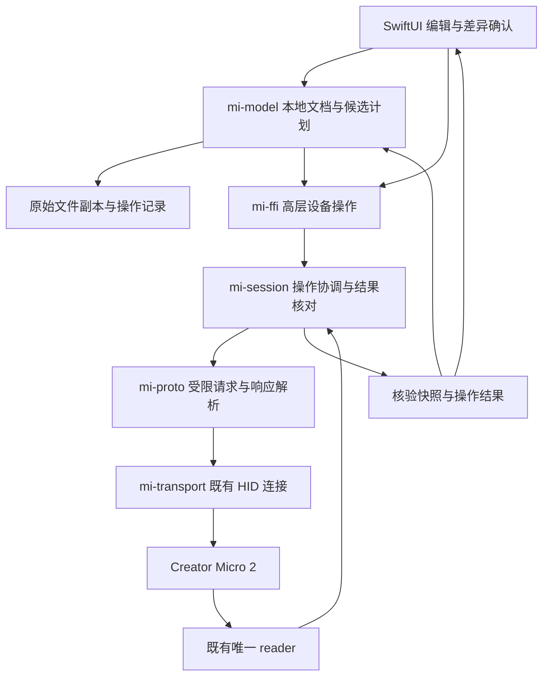

# Micro Input 设备改键与 RGB 控制

- **Author:** semantic-craft
- **Status:** Implemented in part — 用户已授权实机验收；配置应用/同连接原字节恢复已接线并取得最小 RGB 配置读回证据（E-108），即时预览和实体效果仍未验收
- **Date:** 2026-11-03
- **Context:** 本机 REA 调查与实施建议 `.scratch/input-study/rea-s3-rgb-20261103/implementation-plan.md`（本地研究材料，未随 Git 分发；正式协议与模块依据见文末）

## 当前原生预览契约（2026-11-04）

本段与更新后的 SPEC R-E11 取代下文初版中将“实读运行态及可恢复”作为原生预览前提的约束；下文 E-103 的恢复行为仅适用于合成模拟器。

原生预览为显式设备级操作：将所选草稿灯光的两区已知参数发送到当前核验连接，不切换 Profile/Layer、不写配置文件。结束、关闭或 30 秒到期停止待发更新并等待在途请求，返回 Stopped；不声称自动恢复或运行态读回。失败停止且不重发，明确断连退役旧预览。合成恢复模拟器的 Restored/原子比较不作为原生开放前提。

唯一 USB Creator Micro 2 / 0.6.3 与现有连接能力共用门禁；会话单 reader、单在途、最新值合并保持不变。预览候选只进入私有 typed `exchange_lighting`，一般 RPC/编码字节出口仍只读。预览中的滑杆拖动更新待发值；“保存预览到草稿”绑定进入时的文档 ID/revision，一次保存两区并结束，继续使用统一审阅、备份、写回和恢复链路。

来源层完全缺少 `lights` 时，显式“添加灯光设置”使用 Input 1.1.0 Creator Micro 2 的两区初值；已有 null、未知或坏结构不被缺省覆盖。编译在原层结尾插入灯光成员，其他字节保持不变。添加后的编辑、撤销与重开复用 v2 文档，不新增格式。

本轮只离线实现与验证，不连接设备。剩余实机验收为预览实际效果、关闭行为、六种效果及配置应用后的视觉结果；文件读回和合成 ACK 均不能替代这些结果。

## Overview

让用户在 Micro Input 中将普通键位修改应用到 Creator Micro 2，并调整 Backlight 和 Underglow 的颜色、亮度与灯效。用户应当能明确区分本地草稿、设备已接收的修改和已经核验的设备结果；改变一个键或一个灯区时，其他已有设置应得到保留。

当前产品具备本地配置编辑、设备配置读取、单键应用准备和原配置副本。E-108 已为 USB Creator Micro 2 / 0.6.3 接通审阅计划的配置应用与同连接恢复；一般 RPC 仍只读；原生即时预览现已实现离线路径，实机视觉未验。Mac 宿主动作已经有独立执行路径；它不能替代设备侧普通键位设置。

本设计依据 Input 1.1.0 的静态研究。官方客户端具有 keymap 配置写入、随 Layer 提交灯光设置和即时灯光预览的代码路径。该发现说明存在可研究的兼容协议，不证明 Micro Input 已具备这些能力，也不证明当前固件上的写入与恢复已经通过验收。

采用 Layer 内保存灯光目标状态的方案；改键与 RGB 共用设备操作流程。尚未验证的设备协议问题见 Open Questions。

## The Problem

用户目前可以在 Micro Input 修改本地草稿，但不能将普通设备键位应用到键盘；RGB 控制也没有完整的产品入口。要完成这些操作，仍需要官方 Input。

缺口不只是界面上缺少按钮。现有应用准备停在生成候选与保存副本，尚未形成发送、核对实际结果和恢复原设置的完整流程。发送成功不等于目标键位或灯光已经正确生效；中途失败也不意味着设备保持原样。

灯光操作包含两种不同的用户行为：提交新的灯光设置，以及临时预览。官方预览链具有代码依据，但关闭面板后的恢复行为还没有足够证据。产品不能把关闭面板显示成“已经恢复”，除非设备效果确实可核验。

设备改键也会与现有 Mac 宿主控制发生交叉：如果被修改的键原来用于发送 AG 通知，换成普通设备按键后，对应宿主动作可能不再触发。用户需要在应用前看到这项影响。

## Goals

### G1 将普通键位修改应用到明确的设备

用户可从已核验设备配置建立草稿，修改普通键位，查看具体目标及前后差异，再明确应用。完成条件同时包括配置读回相符和目标实体键行为符合预期；两项证据分别记录。未修改的映射、配置结构和未知字段保持不变。

### G2 调整两区 RGB 设置

用户可分别调整 Backlight 和 Underglow 的颜色、亮度与支持的灯效。修改一个灯区不覆盖另一区或键位。完成条件包括配置读回及硬件灯光效果核对；有代码枚举但未验证的效果不能显示为已经支持。

颜色、亮度和灯效均属于目标范围。先完成 Solid 等较小子集可以作为交付顺序，但不能将它描述为全部 RGB 功能已经完成。

### G3 提供明确的灯光预览与结束行为

用户明确启用预览后，参数变化可以作用于设备；普通浏览和草稿编辑不隐式调灯。原生预览为显式设备级操作：将所选草稿灯光的两区已知参数发送到当前核验连接，不切换 Profile/Layer、不写配置文件。结束、关闭或 30 秒到期停止待发更新并等待在途请求，返回 Stopped；不声称自动恢复或运行态读回。失败停止且不重发，明确断连退役旧预览。合成恢复模拟器的 Restored/原子比较不作为原生开放前提。

### G4 保留并恢复原设置

应用前保存可核对的原始配置。用户可恢复本次修改前的设置，恢复后核对配置及目标键位或灯光行为。发生超时、断连或部分写入时，保留草稿和操作记录，明确区分尚未发送、结果未知、设备核对成功以及本地保存失败。

### G5 保持宿主控制的边界清楚

普通设备键位与 Mac 宿主动作保持分型。若应用变更会替换宿主路由所依赖的绑定，应用前说明受影响动作；应用或恢复后重新核对路由依据，避免沿用已失效的映射。

### G6 形成可以逐步验收的实现计划

技术章节和实施清单明确现有模块的复用范围、需要新增的行为、文件改动和各阶段验收条件。离线验证与设备实测分别记录；每项生产能力只在其自身验证完成后开放，不用临时文件探针或合成测试代替真实配置验收。

## Non-Goals

- 断电、重启或换电脑后的保留效果不作为本次核心验收；可以在后续补充测试。
- 不升级、替换或重新编译键盘固件，不进入 bootloader，不建立固件烧录流程。
- 不在本设计中新增宿主 Agent 动作、自动 Profile 切换、浮窗或其他 S4/S5 功能。
- 不将普通宏、Multi Action、Smart Actions 的新增编译和多文件更新作为首个普通键写入闭环的前置工作；已有内容必须保留。
- 不扩展到其他键盘型号、BLE 或未经验证的固件版本。
- 不复制官方应用或 SDK 实现，不使官方 Input 成为 Micro Input 的运行依赖。

## Open Questions

以下为仍需后续证据解决的设备研究缺口，不因设计定稿而视为已经验证。

1. 当前固件覆盖现有 keymap 文件、缩短文件及末块完成标记的实际行为，以及失败后恢复原配置的可靠路径。
2. 即时预览如何对应当前设备活动层，如何核对已经发出的预览恢复；保存文件读回不能单独证明实时灯光状态。
3. 各灯效在目标硬件上的支持范围和视觉效果，以及 Magic 参数应如何向用户解释。
4. 官方 Input 与 Micro Input 同时访问设备时的冲突处理；单个客户端内部排队不等于跨进程独占。

## Critical User Journeys

### CUJ 1 应用普通设备键位

- **Given:** 用户连接已支持的设备，取得完整核验快照，草稿能唯一定位到源 Profile、Layer 和控件。
- **When:** 用户修改普通设备键位，审阅差异与宿主动作影响，并点击应用。
- **Then:** 应用重新核对设备与基线，保存恢复材料，执行写入并读回。界面分别报告配置核对结果和实体行为验收状态；其他映射保持不变。

### CUJ 2 调整灯光并提交

- **Given:** 用户正在编辑一个来源明确的 Layer，两个灯区的原始值均已保留。
- **When:** 用户修改一个灯区并应用。
- **Then:** 仅计划中列明的灯光字段改变；另一灯区、键位和未知字段不变。读回完成后更新设备快照；硬件颜色、亮度与效果单独核验。

### CUJ 3 结束灯光预览

- **Given:** 当前活动层与原灯光设置已经确认，预览恢复路径已通过对应设备验证。
- **When:** 用户启用预览、调整参数，然后结束预览或关闭面板。
- **Then:** 停止待发更新，处理已经发出的请求，再按已验证协议恢复预览前状态。无法确认恢复时明确保留未知状态，不显示恢复成功。

### CUJ 4 中断后检查与恢复

- **Given:** 写入或预览可能已经改变设备，但发生超时、断连或应用退出。
- **When:** 用户重新进入操作界面或明确重新连接设备。
- **Then:** 应用展示保留的操作记录；不自动续写。重新核对后区分原状态、目标状态和无法归类的状态，再允许用户进入适用的恢复流程。

## Technical Plan

### 1 模块职责与数据流

沿用 Rust 核心与 SwiftUI，以及当前每个连接唯一 reader 的结构。配置写入和预览共享已有设备会话，不新增旁路 HID 句柄。Swift 负责展示与用户操作；计划生成、权限范围校验、协议状态和结果核对在 Rust 内完成。

| 模块 | 本方案新增职责 | 保留边界 |
| --- | --- | --- |
| mi-model | 编译键位或灯光变更、生成明确差异与候选摘要、保留原值 | 不持有 HID，不发送 RPC |
| mi-session | 管理配置操作或预览的占用期，逐块执行，核对结果与恢复 | 唯一 reader、会话失效和迟到回应隔离继续有效 |
| mi-proto | 定义受限写入及灯光请求，校验参数并解析响应 | 原只读接口仍拒绝写方法，不提供任意 method 出口 |
| mi-transport | 沿用现有连接的报告读写和关闭 | 不解释配置或执行宿主动作 |
| mi-ffi | 暴露准备、应用、取消、恢复和预览的高层操作 | Swift 不传任意设备文件、原始载荷或 RPC |
| SwiftUI Store | 显示草稿、计划、设备快照与操作状态 | 普通浏览、本地编辑、选择 Profile 不隐式写设备 |

### 2 四类数据分别管理

**本地草稿**记录用户想要的变化，沿用文档身份、修订和撤销。**设备快照**记录读回的原始文件、完整性与身份，不能以草稿替代。**应用计划**冻结一次已审阅的变更及目标文件字节。**操作记录**记载执行到了哪一步，用于异常后诊断；它不改变原始副本。

现有 `mi-model/src/apply.rs` 的准备对象和副本机制作为计划生成的起点。计划至少绑定文档 ID/修订/磁盘摘要、设备身份/固件/会话、两文件基线摘要与有无、明确的源对象、变更清单和候选摘要。公开 token 只用于查找 Rust 持有的计划，不能单独作为有效凭证。

确认后的计划不可随草稿变化而更新。再次编辑、重连或基线改变会使计划失效，需要生成新的差异。点击两次应用不得产生两次写入：同一计划只能被一个操作占用，重复调用返回该操作或明确拒绝。

候选编译沿用原字节保全方向：普通键替换已定位的 token；灯光只替换计划中的字段范围。普通编辑的编译前后均解析核对结构，证明目标变化与计划相符；损坏配置恢复不编译现状，直接使用已核验副本作为目标，按下节的原始字节恢复规则核对。未列入计划的内容必须保持原字节；范围重叠、源 ID 歧义或缺少所需结构时拒绝编译，不能退回整份默认序列化。缺失灯光结构的创建规则须在具体模型方案中定义，不能随浏览自动补默认值并发送。

### 3 配置应用与恢复

应用操作先核对当前身份与完整配置，再核对计划基线和已保存的原始副本。核对失败且尚未发出任何变更时，终止为“未发送”。通过后锁定操作范围，发送候选 keymap，完整读回，比较候选原字节并确认 smart_actions 未变化。

首个执行闭环不需要改写 smart_actions。若计划包含本功能尚不支持的动作变化，应在准备时拒绝，而不是忽略或隐式扩展为双文件更新。官方普通配置链未证明多文件原子事务，因此这里不依赖 `fs.txbegin/fs.txcommit`。

写入使用 `fs.writebin` 的已识别参数形态，逐块等待并检查回应；块大小、覆盖及末块触发生效语义，按实机证据开放。官方 3072 字节仅是候选上限，不由小临时文件实验推定已通过。整个操作期间禁止其他配置提交和预览插入，读取与验证由操作内部按顺序完成。

| 状态 | 含义及允许行为 |
| --- | --- |
| Prepared | 已审阅候选和副本，未发送；可放弃 |
| Revalidating | 正重新核对设备与基线；仍可能无副作用退出 |
| Writing | 至少可能已发送变更；取消只停止后续发送 |
| Verifying | 核对实际设备文件；尚不显示全部完成 |
| Verified | 文件与候选一致；实体按键/视觉验收单独记录 |
| VerifiedLocalSaveFailed | 设备已核对，但本地保存失败；只允许修复本地记录，不重发设备变更 |
| NotSent | 确认没有发出变更；草稿和计划信息保留 |
| DeviceStateUnknown | 不能排除设备部分改变；禁止自动重试、续写及覆盖 |
| OriginalVerified | 后续明确只读核对确认文件等于原配置；允许继续编辑，不声称历史上从未发送 |

首次可能发送前持久化操作身份与候选/副本关联。崩溃后不能仅凭“未收到完成回执”判断未写入。重启只展示记录；明确重新连接后先读取判断当前文件是否等于原配置或目标候选，均不等时进入诊断，不擅自覆盖。

恢复是新操作，使用原副本作为目标候选。设备后来变化使旧恢复计划失效；重新读取、展示将覆盖的内容并明确审阅后，才生成绑定当前原始字节的新计划。执行前再次变化则再次拒绝，不自动覆盖。恢复后同样读回核对，保留原操作与恢复操作的关联。

恢复复核将“限定文件原始字节已完整读取并校验”与“配置能解析”分开：正常查看和应用仍要求可解析；中断后 keymap 可读但不可解析时，允许用已校验原始字节准备受限恢复，展示整文件覆盖范围而不伪造字段差异。恢复只写 keymap，保持本次恢复前 smart_actions 的有无与原字节不变；若它与原备份不同，提示并保留该变化，不声称整套旧配置已恢复。恢复目标必须是原操作关联的完整副本，且设备身份和固件已确认。keymap 缺失、文件无法完整读回、摘要不符或身份不明时，本版拒绝发送并保留诊断材料；不新增通用修复或双文件事务。

现有 `BridgeError::Timeout` 等提示面向只读重试。写操作不得沿用“超时后重试”的通用提示，而应携带操作阶段与是否可能产生副作用，由 UI 展示具体下一步。

### 4 灯光编辑与候选编译

领域参数分为 Backlight/Underglow 两区，每区保留 effect、brightness、speed、magic 和 color，以及尚不理解的原始字段。UI 使用 0–100 的滑杆值；协议数值按当前官方客户端规则转换为 0–1。颜色在界面使用六位 RGB hex，在设备候选中为 RGB 整数。转换集中在 Rust 模型，避免 Swift 与编译器分别解释。

已知枚举为 Off、Solid、Snake、Rainbow、Breath、Gradient。未知枚举可查看并保留，不能自动改成 Off。支持编辑哪些参数依照所链接的客户端规则及设备验收能力；Magic 在效果含义不清楚时不赋造名称。

客户端参数约束见[RGB 静态参数规则](../protocol-candidates.md#rgb-静态参数规则)。禁用参数保留原值，不自动清零；该表不是设备支持证明，未知效果不获得编辑权限。

灯光修改经本地草稿、差异和应用操作生效。“应用到当前 Profile 所有层”先展开受影响层清单；保留另一灯区，作为一次可撤销的本地修改。此入口安排在完整 RGB 阶段，按实施清单验证后开放。

RGB 配置提交复用上节的应用与恢复流程，不新增另一套设备写入器。候选核对必须证明键位原字节未变，不能仅比较灯光字段。

### 5 即时预览的生命周期

预览具有独立的 begin/update/end 高层职责。开始时确认设备、活动层来源与两区原值，登记预览会话；普通编辑不会启动它。设备能力未验证或活动来源有歧义时，该入口不可用。

每次更新仅保留最新待发参数；同一时刻最多一个预览请求在途。防抖时间是产品参数，官方 500 ms 可供比较，不是固件协议约束。预览期间仍使用唯一 reader；连接代次改变即使所有旧更新失效。预览 token 同时绑定开始时的设备活动 Profile/Layer；同连接切层也使旧目标失效。发现活动来源改变或无法确认时，停止更新并清除待发任务，不向新层发送旧层恢复值，保留实时状态未知。仅在协议已经验证能把更新与恢复作用于所绑定目标时开放预览；单次查询后仍可能切层，不能当作无竞态保证。当前证据不满足时保持预览关闭，作为未交付能力，不另建后台轮询或 AppSense 服务。

结束顺序为：禁止新更新 → 清除待发任务 → 处理在途请求 → 发送已验证的恢复操作 → 核对结果。旧更新不得晚于恢复请求发送。若在途请求超时且无法确定执行顺序，结束为状态未知，不能用又一次发包掩盖不确定性。开始预览时为结束恢复及协议核对预留请求编号；每次更新在同一会话队列内检查余额，仅在发送后仍足够结束时放行。余额不足立即停止更新并使用预留额度结束；其他读请求也不得消耗该额度，结束后释放。不能靠自动重连继续预览。

从预览进入配置提交前必须结束预览并处理其结果，再重新核对配置。预览恢复失败时不继续提交。休眠、断连或异常退出可能使恢复请求无法发送，此时保留状态未知，重连不自动恢复或重放。

必须区分“恢复请求得到回应”“保存文件未变”和“灯光实际恢复”。若当前协议没有实时灯光读取能力，视觉结果需要硬件观察；不得把 ACK 或 fs.readbin 结果标成自动核验了视觉状态。

### 6 宿主路由与其他客户端

设备配置开始改变前关闭所有宿主动作的新执行入口（包括硬件输入和 UI 试运行），使旧路由代次失效、清除按住状态并处理必要的释放。Store 有界等待已经进入执行器的动作结束，不能把取消订阅当作动作已停止；排空超时本次设备操作终止为 NotSent。只有排空完成才允许首次变更发送，旧回调不能恢复路由或覆盖新状态。

写后以新快照对既有受支持绑定逐项核对，结果由 Rust 统一产生并用于订阅与动作解析。复用已有物理映射表，核对活动来源、原始位置、token 含义及唯一性，不以整层13槽数量代替映射验证。只停用被替换或无法核实的绑定，其余经核实后恢复；宽键关联开关作为同一逻辑控件，任一不满足则整个宽键宿主动作停用。不支持重新布置 AG/ACT；重复、移位或未知关联拒绝对应绑定。设备身份、活动来源或整体状态不明时全部暂停。RGB-only 同样重验；活动来源后来改变使结果失效，不能把旧结果跨层复用。

现有 AG/ACT 虽被通用投影保留为 Unknown，单键准备可依据既有受支持映射有限识别其原值；只有来源唯一且位置明确的已知 AG/ACT 可被普通键替换，其他 Unknown 继续拒绝。目标仍限首阶段六项 DeviceKey，不引入通用 token 注册器。应用前列明受影响逻辑控件；普通设备键不作为 AG 事件执行。

操作锁只保证 Micro Input 内部不交错，不能防止官方 Input 同时写入。设备无已验证的跨进程锁时，提交前基线核对和提交后读回只能发现部分冲突，不能证明没有竞争。生产支持条件应明确要求没有另一配置器同时控制设备；检测到已知冲突时拒绝开始，并由用户处理，不擅自终止其他应用。跨进程共存能力未验证前不能宣称安全共写。

### 7 灯光目标状态归属于 Layer

采用作者确认的 A 方案：在当前本地 Layer 模型中保存可选的灯光目标状态。界面显示、编辑、撤销、复制与保存均围绕这一份目标状态工作，不额外维护一套按 Layer 引用关联的灯光修改记录。

设备快照仍完整保留原始文件。应用准备时，以来源明确的基线与 Layer 目标状态计算实际变化，再生成限定字段的写入候选。保存完整目标状态不等于提交时重写全部字段；未知参数、另一灯区和键位的保全要求不变。

临时预览和操作进度属于设备会话，不写入 Layer 作为目标状态。撤销本地灯光编辑也不等于撤销已经发出的设备请求；已应用的修改通过显式恢复处理。

这一选择能覆盖两区参数、各灯效、层复制及当前 Profile 多层应用，不需要为了增加效果种类而引入新的持久化机制。源配置缺少 lights 时仍保留“缺失”与“明确设置”的区别；浏览不会补默认值。需要创建灯光对象时，必须是可审阅的本地编辑，其可编译性按已验证 schema 判断。

已核对当前 `Draft::from_bytes`：v2 解码后会将重新序列化的值与输入比较，存在未知字段时进入只读；自有预设导入也拒绝只读文档。因此采用可选字段扩展 v2，保持现有类型名，不作全库 v3 迁移。未编辑旧文档不补写新字段；含灯光编辑的文档在该旧读取器中只读，不能保存或正规化导出。该结论只覆盖本次核对的旧读取器，其他历史版本未验证。固定旧读取逻辑的回归证据是实施验收条件。

## Alternatives Considered

### B 在文档内保存独立灯光修改记录

该方案保持 Layer 的原投影，在文档中另存按稳定 Layer 引用关联的字段变更；显示和编译时，将变更与基线合成。

**优点：** 哪些字段被修改可以直接表达；如果未来产品以跨设备复用规则、补丁分发或选择性重放为主要目标，这种表示可能有价值。

**代价：** 每次显示都要合成状态；撤销、复制层、导入、删除和重建基线都必须维护额外的修改记录。源引用失效时不能继续重放；错误重映射可能把修改应用到另一层。为了显示完整配置，仍然需要生成完整灯光状态，因此没有消除状态模型，只是增加了一层表示。

**不采用理由：** 当前需求以编辑和提交 Layer 配置为主，没有独立补丁重放的目标；B 不增加当前功能覆盖，却增加引用维护与状态合成成本。

### 已选 A 的局限与约束

A 的优势来自复用现有 Layer 和文档机制，不意味着可以直接重建整份厂商 JSON。若实现只保留已知灯光字段、无条件填默认值，或者旧版本保存时丢弃新字段，同样会造成数据损失。

因此，A 的成立条件是保留原始配置和未知值、按实际差异编译、验证本地格式兼容，并将设备执行状态与文档状态分开。若这些条件未满足，不能以“模型更简单”为理由开放设备写入。

## Detailed Implementation Plan

### 实施顺序与范围

以下为完整实施清单；表中“新增”描述相对设计起点的文件变化，不代表该行全部完成。各段实际完成范围见下文及 E-100/E-101/E-102/E-103。所有路径相对于项目根目录。原始分析材料继续留在 `.scratch/input-study/`，不进入产品构建。

1. **文档与候选：** 完成 Layer 灯光状态、旧格式兼容、差异编译和恢复材料；准备过程零设备发送。
2. **单键闭环：** 在合成后端完成单个普通键的写入、读回、恢复及失败状态。首个原生验收沿用已有六项 DeviceKey token，不顺带扩展宏、旋钮或摇杆编译。
3. **基础 RGB：** 两区的 Off/Solid、颜色和亮度，复用同一个执行器；编辑、撤销、重开和仅目标字段改变全部验证。
4. **完整 RGB：** 增加其余四种灯效、适用的 Speed/Magic 参数和当前 Profile 全层应用；再完成显式即时预览及退出恢复。不同效果按各自证据开放；阶段 3 不能被报告为全部目标完成。
5. **设备验收与开放：** 离线检查完成后，取得具体设备操作范围授权，再执行下面的最小实机验证。没有相应证据的原生能力保持禁用，不以环境变量绕过。

本设计覆盖完整后续工作；当前先实施文档模型、候选编译及合成后端验证，已补持久操作记录与失败恢复的离线核心，已接入仅合成后端可用的产品写入协调与恢复界面（E-102），已接入 RGB 编辑与合成预览（E-103），原生预览和实机验收仍未开放。没有固件回应证据时，先完成失败路径与“不可用”行为，不臆造 ACK schema、覆盖规则或恢复保证。

首段已实现 Layer 可选灯光目标、编辑/撤销/复制/保存及三方比较、单键或灯光原始字节候选、备份后一次消费的计划，以及仅合成后端可用的分块发送与读回验证工具。自编夹具位于 `crates/mi-model/fixtures/device/synthetic-keymap-lighting.json`。下一段已补持久操作记录、损坏配置新计划恢复、失败后独立读回核对和幂等本地修复（E-101）。宿主排空与逐绑定恢复、高层 FFI/恢复界面已离线实施（E-102）；RGB 编辑界面和仅合成后端的临时灯光状态机已实施（E-103）；原生即时预览仍待目标绑定/恢复证据。

### 1 本地模型、存储与候选

| 文件 | 动作 | 具体改动与理由 |
| --- | --- | --- |
| `crates/mi-model/src/lighting.rs` | 新增 | 定义两区目标状态、已知效果与未知原值、RGB 整数及有限 0–1 参数验证；统一显示换算与差异计算。未知原值允许保留，不允许用默认值覆盖 |
| `crates/mi-model/src/lib.rs` | 修改 | 注册灯光、操作记录模块；保留设备 `Lights` 原值投影，与本地可编辑状态分开 |
| `crates/mi-model/src/device.rs` | 修改 | 为灯光原值投影提供来源与已知参数识别；异常和未知灯光不使其他可读配置消失，也不升级为可写能力 |
| `crates/mi-model/src/document.rs` | 修改 | `LayerNode` 增加可选 `lighting` 目标状态；缺失字段不序列化。扩展验证、视图、复制层、创建层与结构差异。旧文档仅显示来源灯光，首次明确编辑才写入目标状态 |
| `crates/mi-model/src/draft.rs` | 修改 | 新增单区编辑、重置本地灯光编辑、当前 Profile 全层应用操作；统一经过 mutate/undo/redo，不发设备请求。保持未知字段只读检测 |
| `crates/mi-model/src/storage.rs` | 修改 | 接入灯光原子保存；修正 `prepare_apply_backup` 清掉计划的问题：副本完成后转为 Prepared 并保留冻结候选，只有取消、失效或执行终结才释放。计划占用状态与文档修改互相校验 |
| `crates/mi-model/src/apply.rs` | 修改 | 从单键准备扩展为明确的 SingleDeviceKey 或 Lighting 计划，不支持两类混合提交；用 RawValue 范围替换已知字段。保持实际候选字节、基线与副本摘要绑定；允许唯一已知 AG/ACT 原绑定替换，其余未知原值拒绝；生成原副本恢复候选，旧计划遇新变化失效，重新审阅后生成新计划 |
| `crates/mi-model/src/operation_record.rs` | 新增 | 管理每次操作的私有持久记录、阶段及恢复关联，使用现有摘要与原子落盘模式；首次可能发送前确保落盘，持久化已核验结果及本地修复所需文档身份、修订、原字节摘要和候选关联；重启不执行设备动作 |
| `crates/mi-model/src/comparison.rs` | 修改 | 三方比较覆盖已知灯光差异和未知字段变化；接受设备状态后重建基线，不能把已提交灯光再次当作待应用修改；消除投影与 raw 中灯光重复计算的歧义 |
| `crates/mi-model/src/preset.rs` | 修改 | 层/配置复制与预设往返保留目标灯光；安装或清理默认预设时将灯光编辑纳入“已修改”判断，避免删除用户只改过灯光的配置；仍不导入操作凭证或设备写权限 |
| `crates/mi-model/src/recovery.rs` | 修改 | 本地文档恢复保留灯光目标状态；高版本和未知字段继续只另存原字节，不能与设备恢复混为一谈 |
| `crates/mi-model/src/agent.rs` | 修改 | 原有提案重放和文档校验保留灯光，不扩大允许的 patch 操作；Agent 本地提案仍不获得设备执行入口 |

`lighting` 保存完整的当前目标状态，未编辑文档缺失该字段时视图从源档案读取。字段内保留无法解释的原值；字段外出现尚不支持的本地文档结构时仍只读。禁止将“字段缺失”解释成 Off。

对于源 Layer 完全缺失 lights 的情况，首个编译器拒绝设备提交并给出具体原因；用户仍可编辑本地草稿。确认当前固件接受的完整两区结构后，才能以显式结构创建变更开放该路径。正常两区灯光的完整功能不依赖猜测缺失字段语义。

操作目录位于当前文档的私有数据目录下，每个操作使用独立 ID；目录 0700、文件 0600。不可覆盖的原配置与候选文件沿用准备机制；可更新状态文件经临时文件、fsync、原子替换及目录同步保存。当前实现复用 `device-backups/<operation_id>` 原副本，在其 `operation/` 子目录保存状态、冻结材料关联及本地文档前后版本；不会重复复制设备文件。只记录身份摘要、候选摘要、阶段、已确认块数、错误类别和关联路径，不记录宏明文或完整 RPC。恢复材料不自动删除；本方案不新增历史清理服务。

### 2 协议、会话和输入路由

| 文件 | 动作 | 具体改动与理由 |
| --- | --- | --- |
| `crates/mi-proto/src/lib.rs` | 修改 | 注册受限变更协议类型；保留公开只读 Method/request 的语义，不给既有调用者新增任意写方法 |
| `crates/mi-proto/Cargo.toml` | 修改 | 复用仓库已有 base64 作为候选块编码器的直接依赖，不新增第三方库 |
| `crates/mi-proto/src/mutation.rs` | 新增 | 配置块与灯光预览请求构造、严格参数校验、错误回应解析；路径只允许计划指定的 keymap，offset、completed 和大小由候选计算，拒绝附加字段与通用文件操作 |
| `crates/mi-proto/src/native.rs` | 修改 | 保留 `validate_read_only` 拒写语义，增加变更请求的独立校验入口；编号报告帧格式不变 |
| `crates/mi-session/src/lib.rs` | 修改 | 接入操作协调，复用请求队列、reader 和 pending 关联；抽出内部已校验发送路径供只读和受限变更调用，避免公共 request 绕过校验。处理请求 ID 剩余空间与生命周期取消 |
| `crates/mi-session/src/config_write.rs` | 新增 | 实现计划占用、复核、逐块写入、完整读回、恢复及操作状态；同一连接最多一个变更操作；正常应用要求可解析基线，受限恢复允许不可解析但完整校验的现状；异常后不自动重试 |
| `crates/mi-session/src/lighting_preview.rs` | 新增 | begin/update/end、最新待发值、单个在途请求、退出时排空与恢复；旧 generation、活动来源变化和预览 token 无效；预留结束请求额度；配置应用与预览互斥 |
| `crates/mi-session/src/files.rs` | 修改 | 抽出限定文件原始读取与完整性校验，正常快照再解析，损坏配置恢复使用已核验原始字节；提供内部持锁读取路径，防止高层持有队列后再次调用公共读接口造成死锁 |
| `crates/mi-session/src/input.rs` | 修改 | 配置变更期间暂停可执行输入输出，清空宽键和按住状态；协议 reader 继续工作。恢复路由前要求重新核验绑定，不把写入时收到的通知积压到之后执行 |
| `crates/mi-model/src/host_router.rs` | 修改 | 复用有限 AG/ACT 识别与物理映射表，按位置/含义/唯一性生成逐绑定核验结果，宽键成组；失效后拒绝旧代次动作，重新核对后只恢复合格绑定，保持宿主 Profile 选择与设备活动 Profile 分离 |
| `crates/mi-transport/src/lib.rs` | 修改 | 仅扩充 synthetic-backend 的可变设备文件、预览状态与故障模拟；fs.list 根据实际保存字节计算 size/SHA-1，不使用计划期望摘要；生产 HID 打开、分帧后写入及句柄所有权不变 |
| `crates/mi-transport/Cargo.toml` | 修改 | 将仓库已有 sha1 版本作为 synthetic-backend 的可选直接依赖，仅合成后端启用 |
| `Cargo.lock` | 必要时更新 | 仅记录上述依赖关系，不顺带升级无关依赖 |

原生能力按型号、固件和已验收操作查询，至少区分配置提交、恢复和灯光预览。只读身份确认不自动解锁写入。合成后端能力只在编译的 synthetic-backend 中存在；原生接受任意环境变量、UI 布尔值或自称 synthetic 的固件字符串均不得解锁。

在首块前计算包括前置复核、所有写块及读回所需的请求 ID 上界。若剩余空间不足，在零变更状态拒绝并要求明确重新连接；不能写到一半因 0–998 ID 空间耗尽而自动换会话续写。配置大小使用现有模型/会话上限，不能为通过测试放宽。

编译或文件检查失败零发送。记录保存失败时，尚未发送则 NotSent；可能已发送且设备尚未核验成功时，停止后续变更并返回 DeviceStateUnknown；设备已经核验成功后的本地持久化失败进入 VerifiedLocalSaveFailed，不抹掉当前进程已知的设备结果。任何一次传输错误都不通过读取旧缓存生成 Verified。

### 3 UniFFI 与 SwiftUI

| 文件 | 动作 | 具体改动与理由 |
| --- | --- | --- |
| `crates/mi-ffi/src/lib.rs` | 修改 | 注册高层操作模块和灯光编辑方法；将能力、操作状态及草稿灯光纳入响应；保留当前只读错误语义，变更错误使用独立结果 |
| `crates/mi-ffi/src/apply_preparation.rs` | 修改 | 保持 preview/cancel/prepare 原职责，返回可查询的 Prepared 计划身份；重复保存副本不创建重复执行权限 |
| `crates/mi-ffi/src/device_operations.rs` | 新增 | 提供 start_apply、operation_status、cancel_operation、prepare_restore、start_restore、retry_local_save(operation_id)；协调文档和会话，状态更新回写本地记录；Swift 不提供文件路径或候选载荷 |
| `crates/mi-ffi/src/lighting_preview.rs` | 新增 | 提供 begin/update/end 预览及高层参数校验；仅接受当前预览 token、明确灯区和已验证参数 |
| `crates/mi-ffi/src/input_monitor.rs` | 修改 | 将变更期间暂停和逐绑定重验结果传给宿主输入订阅；动作解析使用同一核验结果及路由代次；不制造假硬件通知或自动 provision |
| `crates/mi-ffi/src/reconnect.rs` | 修改 | 重连使旧计划与预览失效，提供中断操作的只读核对结果；不自动续写或恢复 |
| `app/MicroInput/Sources/MicroInput/Model.swift` | 修改 | 解码灯光视图、能力及用户可读状态；不在 Swift 重做协议数值转换 |
| `app/MicroInput/Sources/MicroInput/Store.swift` | 修改 | Backend 增加上述高层方法；连接草稿、计划和操作状态；关闭新动作入口、有界排空在途执行、超时零变更，写后只恢复核验通过的绑定；分开本地忙、设备变更与预览状态，结束观察任务时不遗留轮询 |
| `app/MicroInput/Sources/MicroInput/DeviceOperations.swift` | 新增 | 解码操作 DTO，管理有界状态观察和变更提示；向隔离 QA 证据目录输出脱敏 device-operations.jsonl；区分配置核验、行为验收、恢复、未知状态与仅本地保存失败 |
| `app/MicroInput/Sources/MicroInput/ApplyPreparation.swift` | 修改 | 将准备界面接上明确应用、取消后检查、恢复审阅和只修本地保存的入口；设备应用/恢复按钮仅在对应 capability 与有效计划存在时启用；本地修复按冻结材料与修订核验启用，不依赖设备在线或写能力；原始 ID/摘要保留在详情，不增加到普通操作主流程 |
| `app/MicroInput/Sources/MicroInput/LightingEditor.swift` | 新增 | 两区颜色、亮度、效果及适用参数编辑；显式应用和预览入口；全层应用先展示受影响层；未知效果保留并说明不可编辑 |
| `app/MicroInput/Sources/MicroInput/Workbench.swift` | 修改 | 增加当前 Layer 灯光入口与差异查看；浏览层不启用或提交设备配置 |
| `app/MicroInput/Sources/MicroInput/InputMonitor.swift` | 修改 | 显示路由暂停/需重验原因，阻止状态未知期间恢复宿主执行 |
| `app/MicroInput/Sources/MicroInput/WorkspaceLifecycle.swift` | 修改 | 将睡眠、退出和重连事件通知高层操作；有界结束预览，无法恢复时保留记录；不阻塞系统退出无限等待 |
| `app/MicroInput/Sources/MicroInput/MicroInputApp.swift` | 修改 | 接入 synthetic 配置写入和灯光场景；QA 禁止日常设备自动就绪，生产启动不恢复未完成变更 |

接口遵循现有高层调用风格，返回 JSON DTO 或专用 UniFFI record，不能接收通用 RPC。`start_apply` 消费已准备计划并返回 operation_id；状态查询只观察同一操作；恢复必须先生成新的差异与计划。配置调用的取消不会报告“已恢复”。

跨 FFI 操作先在短锁内验证并取得不可变计划/会话引用，再释放同步 Mutex 后等待 I/O；完成后重新检查 generation、文档修订及操作归属再发布结果。禁止持有 Swift/UI 锁或 Rust 同步 Mutex 跨 await。设备写入前原子占用计划；执行期间同一文档的编辑、切换和关闭通过明确 busy/结束流程处理，不让后来的编辑被成功回调覆盖。

设备文件核对成功后，先持久化核验结果及冻结的本地更新材料，再在文档锁和预期原字节检查下更新 baseline 与来源归档，重建相同语义目标，清空跨基线撤销和旧计划。任一本地落盘失败均保留候选与 VerifiedLocalSaveFailed；设备执行阶段已终结，但该文档保持只读直到本地修复成功，允许退出或切换其他文档。

retry_local_save 只按 operation_id 使用 Rust 保管的材料，核对文档 ID、修订、预期原字节摘要及材料完整性后原子更新；重复调用已完成操作返回既有结果，零设备发送。磁盘已经等于目标本地字节时只补记录；出现其他修订或内容时拒绝覆盖，不做自动合并，保留材料并允许另存独立草稿继续工作。重开后只有持久核验结果完整且与候选关联一致时允许离线修复；若成功证据未落盘，显示待核对，需用户明确连接并重新读回确认后才进入本地修复。重新读回属于独立只读操作，不由 retry_local_save 隐式连接或发送。

### 4 自动回归文件

| 文件 | 动作 | 必须覆盖的行为 |
| --- | --- | --- |
| `crates/mi-model/tests/lighting.rs` | 新增 | 颜色换算、参数边界、未知原值、单区与全层编辑、撤销/重做、无变化零候选、缺失结构拒写 |
| `crates/mi-model/src/document_tests.rs` | 修改 | v2 可选字段、复制/新建层、旧文档不补写、固定旧读取器遇新增字段只读且不可保存、未来未知字段保全 |
| `crates/mi-model/tests/apply_preparation.rs` | 修改 | 副本后计划仍有效但只能消费一次、修订/会话变化失效、仅目标字节改变；AG/ACT→普通键→恢复，未知原值拒绝；旧恢复计划遇新变化失效，新审阅计划绑定新字节；混合变化拒绝 |
| `crates/mi-model/tests/operation_record.rs` | 新增 | 首次发送前记录、原子状态文件、中断重开、损坏记录拒绝执行、恢复关联、仅本地保存重试 |
| `crates/mi-model/src/comparison_tests.rs` | 修改 | 灯光三方冲突、接受设备后无重复差异、未知值变化拒绝盲合并 |
| `crates/mi-model/tests/preset.rs` | 修改 | 目标灯光往返和 ID 重映射、只改灯光的预设不被自动清理、导入不能携带设备权限 |
| `crates/mi-model/tests/recovery.rs` | 修改 | 本地恢复保留灯光、未知格式原样另存、不执行设备恢复 |
| `crates/mi-model/tests/agent_cli.rs` | 修改 | 原提案修改后灯光不丢失，新增灯光/设备执行指令继续拒绝 |
| `crates/mi-model/tests/host_router.rs` | 修改 | 逐绑定位置/含义/唯一性核验；被替换项禁用、其余保留；宽键成组、移位/重复/活动来源改变使相应结果失效 |
| `crates/mi-proto/tests/mutation.rs` | 新增 | 拒绝任意路径/附加字段/越界 offset、尾块及回应关联、未授权请求零报告 |
| `crates/mi-session/Cargo.toml` | 修改 | 合成测试复用仓库已有 tempfile 作为 dev-dependency，备份测试自动清理临时目录 |
| `crates/mi-session/tests/config_write.rs` | 新增 | 编译计划经真实 codec/framer/唯一 reader 的合成闭环、每个阶段故障、重复操作、请求 ID 不足零发送；中断留下不可解析文件后受限恢复、身份不明拒绝；实际模拟文件变长/变短/损坏的摘要核对 |
| `crates/mi-session/tests/lighting_preview.rs` | 新增 | 最新值合并、最多一个在途、结束后的旧更新不发送、恢复失败、应用互斥、代次失效；同连接切层禁止旧层恢复；编号临界余额与其他读取不能侵占结束额度 |
| `crates/mi-session/src/file_tests.rs` | 修改 | 写后完整读回、列表摘要不等于字节相等、文件变化与缺失、持锁读取无死锁 |
| `crates/mi-session/src/tests.rs` | 修改 | 原只读边界持续通过、睡眠/断连/取消竞争及迟到回应；不扩大现有 native ignored 测试权限 |
| `crates/mi-ffi/tests/device_operations.rs` | 新增 | 真实桥接对象上计划与会话归属、文档并发变化、无原始 RPC、合成与生产 capability 分离；本地保存失败→重开→离线修复、修订冲突拒绝、重复修复零设备发送、证据未落盘须先独立读回 |
| `app/MicroInput/Tests/MicroInputTests/ApplyPreparationTests.swift` | 修改 | 准备零发送、按钮能力、完整应用与显式恢复、重复点击、未知状态提示 |
| `app/MicroInput/Tests/MicroInputTests/LightingEditorTests.swift` | 新增 | 两区编辑、保留另一灯区、预览开关与关闭、全层清单、未验证效果不可用 |
| `app/MicroInput/Tests/MicroInputTests/DeviceOperationLifecycleTests.swift` | 新增 | 文档/窗口切换、忙状态、取消、后台完成回调、退出与中断重开 |
| `app/MicroInput/Tests/MicroInputTests/SessionLifecycleTests.swift` | 修改 | 睡眠与重连时计划/预览失效，不自动续写 |
| `app/MicroInput/Tests/MicroInputTests/HostExecutionTests.swift` | 修改 | 可挂起/释放的执行器夹具验证排空前零变更、排空后才写；超时NotSent、旧回调不恢复路由；重验后仅合格绑定执行 |
| `app/MicroInput/Tests/MicroInputTests/PresetTests.swift` | 修改 | 经真实 UniFFI 导入导出灯光目标和本地文档重开 |
| `scripts/tests/test_run_verify_launcher.py` | 修改 | 新合成场景隔离、自动就绪关闭、超时清理及重复 QA 运行不残留 |

测试直接使用自编合成配置；不复制用户 keymap、宏或厂商实现。旧读取器回归只固定本项目已存在的旧解析行为及必要输入，验证只读/拒写的实际结果，不用新读取器自测代替旧版兼容证据。

### 5 检查入口、文档与生成文件

| 文件 | 动作 | 具体改动与理由 |
| --- | --- | --- |
| `scripts/check-boundaries.py` | 修改 | 保留原只读/no-send 测试，新增未授权变更零发送与受限操作测试；FFI 扫描扩展到全部源文件，避免新模块逃过原始 RPC 检查。按真实未决项维护 UNKNOWN，不删除约束以求通过 |
| `scripts/check` | 修改 | 纳入所需的新增检查入口并确认 Rust/Swift 新测试均被运行；默认仍不接触硬件、不调用显式设备探针 |
| `README.md` | 修改 | 按实际验收分别记录本地编辑、合成执行、原生开放状态与使用入口，不提前宣称 S3 完成 |
| `docs/development.md` | 修改 | 记录合成场景、生产离线运行方式、默认禁写和设备验收证据位置 |
| `docs/implementation-plan.md` | 修改 | 将本方案阶段与现有 T13 对齐；实施前读取其他任务的最新改动，保留其内容 |
| `docs/module-contracts.md` | 修改 | 更新计划、操作记录、会话写权限、预览职责及错误终态；保留只读接口边界 |
| `docs/protocol-candidates.md` | 修改 | 维护已归入该文档的 RGB 结构、尺度及参数禁用表；设备实测后仅升级相应方法与参数范围的证据级别 |
| `docs/protocol-vectors.json` | 修改 | 加入自编写块、灯光及异常回应向量，标明静态候选或已核验范围，不包含真实载荷 |
| `docs/spec/UNKNOWNS.md` | 修改 | 精确维护覆盖/截断、恢复、预览与共存缺口；局部通过不关闭整项未知 |
| `docs/spec/EVIDENCE.md` | 修改 | 分别记录自动检查、合成应用及后来授权的实机结果，附固定提交和未验证项 |
| `docs/spec/BUILD_PROMPT.md` | 修改 | 对齐已批准的 S3 分阶段范围；保持恢复和显式预览要求，断电跨电脑不列入本次核心验收 |
| `skills/verify-micro-input/features/device-write-and-lighting.md` | 新增 | 编写配置与预览专用验收配方，区分软件、协议、实体行为与视觉证据 |
| `skills/verify-micro-input/features/README.md` | 修改 | 登记新配方及其证据级别，不复用宿主动作回执冒充灯光验收 |
| `skills/verify-micro-input/SKILL.md` | 修改 | 接入新配方与离线场景约束，保留既有隔离和回收流程；不扩大设备操作授权 |

不引入新的第三方库、硬件驱动、后台进程或迁移服务。仅按清单复用已有 sha1、base64 和测试用 tempfile，并更新必要锁文件关系；不手写摘要算法或搬动模拟后端。Swift Package 定义和生产 transport 行为无计划改动；超出此范围的依赖或外部接口变更需先更新设计依据。

`scripts/build` 沿用现有流程，生成 `app/MicroInput/Sources/MicroInputCore/MicroInputCore.swift`、`app/MicroInput/Sources/MicroInputCoreFFI/MicroInputCoreFFI.h`、`app/MicroInput/Sources/MicroInputCoreFFI/module.modulemap` 及 target 下产物。生成文件不手改，不把 ABI 生成当成真实功能验收。本方案不计划删除任何现有文件。

### Verification Plan

#### V1 模型与本地数据

先运行受影响的 Rust 模型测试。逐项证明：旧文档未编辑时原字节不变；新增灯光经过保存、重开、撤销、复制和预设往返后相同；未知字段仍在；计划只改变指定字段；恢复候选等于原副本。检查有新字段的 v2 在固定旧读取路径中只读、不可 mutate/保存/正规化导出。

#### V2 合成协议与故障

配置写入至少覆盖 1、3072、3073 字节及多块候选的编码边界，测试数据为自编内容；这只证明编解码，不表示真实固件接受对应大小。故障注入覆盖首块前、任一中间块、最后 ACK 后、完整读回中、本地落盘时，以及取消与断连竞争。验证未知终态不自动重发、原只读请求不能写、恢复必须有新计划。

另覆盖中断后可读但不可解析的 keymap 恢复、缺失/摘要不符拒绝、恢复前第三方变化使旧计划失效；模拟摘要从实际文件计算，候选变长、变短、损坏均经过真实读回验证。设备核验前后分别注入记录与文档保存失败，验证终态分界以及重开后的证据要求。

灯光验证最后待发值覆盖早期值、结束时取消待发请求、在途请求与恢复排序、没有活动来源时零发送、超时后未知状态、应用与预览互斥。增加同连接切层与请求编号临界余额场景，确认其他读取不消耗恢复保留量。模拟设备状态和保存文件分别维护，从而发现“文件未变就误判灯光已恢复”的错误。

#### V3 项目统一检查

实施后运行 `scripts/check`：Python 启动器回归、Rust fmt、全工作区 Rust 测试、合成 UniFFI 构建与 Swift 测试、生产构建与 Swift 测试、协议边界检查。新增 FFI 集成测试须在 synthetic-backend 条件下构造合成设备，生产编译测试不得回退真实硬件。物理探针保持 ignored；检查输出必须说明哪些硬件场景未运行。该命令的实际执行结果另记入 EVIDENCE。

#### V4 隔离应用闭环

按项目 verify-micro-input 配方完成真实 UniFFI 与 SwiftUI 验证。`config-write` 已实现单键应用/恢复场景（E-102）；`lighting-control` 已实现 RGB 提交/恢复与合成运行态预览/恢复（E-103），不能作为原生预览验收。依次构建合成后端，使用 `MI_AUTO_HOST_READY=0` 和对应 `MI_SYNTHETIC_SCENARIO` 运行 `scripts/run --verify`，设置明确 TTL；核验副本、文档及偏好均隔离。

场景覆盖编辑 → 审阅 → 准备 → 应用 → 读回 → 恢复，以及预览 → 改色 → 结束恢复；补本地保存失败→重开→仅本地修复。宿主动作夹具暂停在实际 await 处，核对排空前零设备变更、排空超时NotSent以及逐绑定恢复。生成 `launcher.json`、独立 `device-operations.jsonl` 和 `result.json`；保留宿主 `audit.jsonl` 的原语义。设备操作回执只包含操作 ID、阶段、结果和摘要，不包含配置/宏载荷。result 分列 `config_readback`、`physical_key`、`lighting_visual`、`restore`；合成运行不得将实体键或视觉项标 PASS。

生产构建仅做离线 QA 时必须设置 `MI_AUTO_HOST_READY=0`，不点击连接或任何设备操作。退出后核对启动器清理回执与进程结束，不能以关闭窗口代替退出确认。

#### V5 后续授权的设备验收

此阶段当前为 **NOT_RUN**，不在本轮执行。正式运行前固定构建、目标设备/固件、具体键或灯区、原副本、允许操作和恢复路径；不照搬其他聊天的探针授权。

| 组 | 最小实验与通过条件 | 未通过时 |
| --- | --- | --- |
| 写入语义 | 独立核实拟用分块、已有文件覆盖/缩短及 completed，以及可读但不可解析现状的受限恢复；范围与探针目标需预先确定，不能直接拿用户 keymap 试边界 | 对应生产能力保持关闭 |
| 单键 | 唯一目标普通键修改（包括已知 AG/ACT 原绑定） → 完整配置读回 → 实体按键验证 → 恢复 → 再读回和按键验证；其他映射及 Smart Actions 不变 | 停止继续改配，保留状态与原副本 |
| RGB 提交 | 每区验证 Solid 颜色/亮度及 Off；核对另一灯区和键位；逐一验其他效果与适用参数，再验当前 Profile 全层应用 | 仅开放已通过能力，不宣称完整 RGB |
| 即时预览 | 明确活动来源，改色、结束及恢复；保存文件不变，硬件视觉效果恢复；另测正常关闭、同连接切层、编号余额不足及可控失败处理 | 预览入口保持关闭，或显示状态未知 |
| 宿主路由 | 只改 RGB 不损坏原路由；改 AG 绑定后不再执行旧动作，其余已核实绑定继续可用；宽键关联整体核验；在途宿主动作排空后才写，恢复并重验后行为正确 | 宿主执行保持暂停并说明原因 |

实体按键使用非敏感目标窗口和操作者操作；视觉结果由能看到硬件的操作者或硬件影像确认。工具读回不能替代这两类证据。断电、跨电脑及破坏性断电故障实验不纳入本次必要验收。

#### 完成条件

离线实现完成须满足 V1–V4、生产禁写和原始数据保全。产品设备功能交付还须满足对应 V5；没有后续设备授权时，报告“离线实现完成、设备能力未验收”，不能报告完整 S3 已完成。配置应用、恢复、每类 RGB 效果和即时预览按各自状态交付。

设计确认阶段仅核对文档；本次首段离线实现的实际验证见 README 和 EVIDENCE，不能把完整 V1–V5 视为已经通过。

## Additional Resources

- [研究成果接入规则](../agents/research-context.md)
- [Input 业务架构与证据定位](../input-architecture.md)：重点 IA-06、07、12、13、17。
- [候选协议](../protocol-candidates.md)
- [现有模块契约](../module-contracts.md)
- [S3 分阶段验收规格](../spec/BUILD_PROMPT.md)
- [项目证据](../spec/EVIDENCE.md)：E-091、E-092、E-097。

*Drafted with EGM*

实施补充（E-103）：当前预览实现采用显式合成测试协议 `synthetic.lights.*`，不把官方候选方法补成未获证的生产协议。合成后端能原子验证目标及最后一次已确认运行态（同层外部修改也拒绝覆盖），并独立读回运行态，故可验证上述生命周期；原生能力维持关闭。编号保留通过一个最长 30 秒持有会话队列的预览任务实现，期间其他读取等待，不引入后台轮询或第二条 HID 通道。自动离线总入口为 `scripts/verify-offline`。

原生候选补充（E-105）：官方SDK成功回包只有通用result/error约束，不能要求自造的written/applied字段；应用结果继续以独立文件读回为准。RGB候选编码只有两区参数，没有活动目标/运行态读回/恢复接口的已验证契约。已实现离线编码、成功包络校验和非合成连接零发送防护；`synthetic.lights.*` 生命周期不接到原生 `lights.preview`。当前协议证据及剩余硬件条件统一见 `docs/protocol-candidates.md` 与 UNKNOWN-08/09/17，不新增自动探针或解除生产门禁。

## E-108 最短交付路线与实机结果

当轮用户明确授权“备份→最小临时文件→配置应用→最小变更并恢复”。改键与已有 Layer RGB 字段复用 `ConfigWriter` 的不可变计划、备份、操作记录、独立读回和 FFI 排空流程，不建立第二个原生预览通道。原生入口只在唯一USB303A:8298、0.6.3和已核实当前连接下开放；未知/缺失灯光结构不补默认值。

`exchange_keymap` 只接收已经编译的 keymap 候选和块偏移；通用 `request` / 编码字节入口仍拒绝写方法。后台reader与发送共享HID句柄，但同一RPC的报告在原生锁内连续发送，避免阻塞读取插在长消息片段之间。连接随机nonce纳入真实基线，原生恢复只能关联同一连接；进程重启、重连和另一设备不能因编号或接口路径相同而套用旧备份。原生即时预览capability保持false。

实机最小变更为未启用Profile的一个已有RGB颜色字段，不切层、不修改其他字段。应用取得完整读回；初次恢复遇无合法ID的400响应而停止，独立读回确认现状后以新计划恢复原字节，连续报告发送修复后的恢复取得Verified。原始键位、完整keymap和smart_actions最终保持原字节。这里只验收配置文件应用/恢复，未进行实体按键或灯效视觉验收，也未验证掉电、跨连接恢复或其他固件。

## 设备编辑与统一配置候选

设备编辑与宿主控制分别拥有文档。设备入口只读取得当前配置后创建独立草稿，宿主文档、选择记录和路由偏好不变；返回恢复同一宿主内存对象。设备草稿另有选择记录，重开默认宿主；继续已有草稿不暗中替换其基线，新建草稿保留旧文件。来源过期时复用现有比较流程，不跨连接自动认可设备身份。

候选编译收集多个普通键与已有灯光字段的实际差异，在原 keymap 字节上修改对应值，统一显示变更列表，沿用同一备份、PreparedCandidate 和 ConfigWriter。未知字段、smart_actions 和未修改内容保持原字节。只支持已有普通键 token 白名单；不增加旋钮、摇杆、宏、结构写入或即时原生预览。旧“单普通键或仅灯光”的限制由本段替代。

验证沿用 config-write 隔离场景，覆盖进入设备编辑、两个普通键加一个 RGB 字段的审阅与应用、逐绑定路由重验、恢复及返回宿主，核对宿主文档和偏好原字节不变。模型回归覆盖混合候选原字节保全和设备草稿重开。真实设备多项应用、物理按键和视觉效果本轮未执行。

2026-11-04 离线验收完成。全工作区 Rust、82 项合成 Swift 的行为检查、43 项生产 Swift、三项隔离应用场景和零发送边界通过。初次集中运行暴露旧提示编号断言和强制保留旧 TODO 的检查，分别修正并仅补跑受影响检查及未执行阶段，没有重复已通过的大套测试。实际隔离界面已核对设备入口、继续草稿和三项混合变更列表；记录在主工作区 `.scratch/device-editing/`。本轮未启动日常安装版或连接真实设备。
