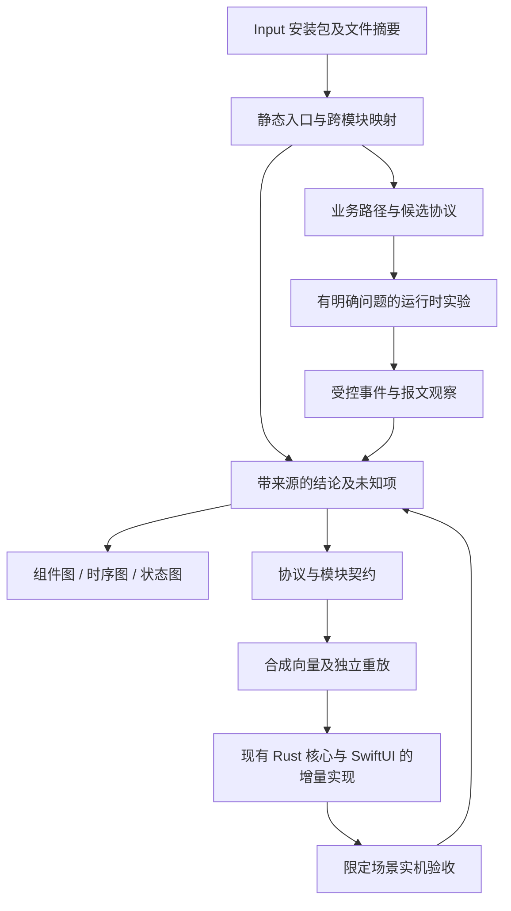

# Input 私有协议与业务架构恢复方案

- 作者：用户（目标与范围）；Codex（设计草稿）
- 日期：2026-11-02
- 状态：已批准设计；最终一致性核对完成，已正式保存。采用 A 本机受控实例；研究与产品实施尚未完成。
- 方法：EGM，按章节审阅。本文是分析工作的设计，不是已经完成的逆向报告。

## Overview — 概述

分析本机 `/Applications/input.app`，恢复它管理 Work Louder Creator Micro 2 的通信契约、配置生命周期和宿主执行边界，形成能够支持独立实现的规格。分析工具以已部署的 Craft Anything CLI/MCP 为入口，现有 REA 证据可用于交叉核对。工具输出需要回到原始文件或受控观察验证，不能直接作为协议事实。

成果用于现有 Micro Input 项目。沿用既定的 Rust 核心 + SwiftUI 方向，后续骨架应补齐现有实现，而不是另建一个重复应用。这里的“驱动管理软件”首先指用户态设备通信与管理程序；是否需要系统扩展必须由具体接口缺口证明，不预设需要编写内核驱动。

目标是完成明确型号、固件和业务场景内的兼容性说明。不会以“捕获所有系统调用”“恢复全部内存状态”或“自动还原所有业务”为前提。架构图覆盖全部目标业务，同时明确标出未验证的连接和条件。

## The Problem — 问题

Input 的界面无法说明配置究竟保存在何处、什么时候写入键盘、哪些动作依赖 Mac 常驻，以及异常后如何恢复。仅看到 API 名称或发送报文，也不足以决定独立客户端应该如何处理状态和错误。

项目已经有 Input 1.1.0 的静态分析、HID/RPC 说明和部分实机读回记录，但各记录的范围不同；不能把单次成功查询当作完整协议或生命周期验收。后续需逐项核对最新实现与证据。

Craft Anything 的发布版与主分支文档也可能不同。安装成功、MCP 可调用、工具返回结果、结果足以支持某个结论，分别是四个不同的验收点。工具没有覆盖的边界必须留下缺口，不能由模型补成事实。

## Goals — 目标与完成标准

### G1 固定分析对象和证据身份

当前观察对象：Input 1.1.0；app.asar 的 SHA-256 为 `a6c7185d5c3d8dda1262437a9c0740080cceaea5585dd289b8eef0668b8a4206`，本轮重新计算，与现有协议记录一致。硬件研究首个范围为 Creator Micro 2 的 USB 路径；0.6.3 是已有记录中的固件版本，后续实机阶段仍须重新确认。

每项关键结论关联应用摘要、工具版本、文件与函数定位或实验场景。区分包内事实、运行时观察、独立客户端实测、推断和未知。完成标准是读者能从结论找到证据，并理解它没有证明什么。

### G2 恢复用于设计的业务架构

交付下列图及解释：

1. 组件与部署图：界面、主进程、worker、设备 SDK、原生模块、本地存储、系统接口、键盘固件之间的边界。
2. 连接与会话图：发现、筛选、打开、查询身份、正常通信、超时、断开、重连与关闭。
3. 配置生命周期图：浏览、草稿、保存、应用、激活、设备持久化和读回；分别解释 Profile、Layer、动作与灯光。
4. 事件与宿主执行图：物理输入、设备通知、宿主分派及动作执行；覆盖普通键、旋钮、宏、Multi Action、AppSense、径向菜单、Cheat Sheet 和宿主 Smart Action 的适用路径。

完成标准：每个目标场景均有从触发到结果的路径，涉及的状态归属、跨进程或设备消息、失败路径和未知项均可定位。不能以节点数量作为完整性指标。静态可达路径不冒充运行时已发生路径。

### G3 形成私有协议与状态契约

交付通信报文、分帧重组、请求关联、通知分派、配置格式、版本兼容和错误处理说明。涉及配置应用时，说明前置条件、提交边界、部分失败、读回和恢复；无法证实的约束不得写成默认值。

完成标准：每个准备进入独立实现的协议操作都有输入、输出、状态影响、超时或失败语义、来源和验证级别。只有静态候选的写操作继续封闭，不因已经列出方法名就开放设备写入。

### G4 产出模块化规格和可验证骨架

在设计完成后的实施阶段，针对现有仓库形成模块职责、接口、状态归属、依赖和错误契约，并补齐必要骨架。实际文件清单须在核对当前分支和其他 worktree 后确定，不能依赖旧进度描述猜测。

完成标准：骨架能够构建，使用脱敏或合成材料重放关键协议场景；未实现的功能显式报告不可用，不以空实现返回成功。模拟测试、实机验收和用户体验验收分别报告。此 EGM 草拟阶段不写生产实现。

### G5 对兼容性作有界验收

以相同应用摘要、硬件型号和固件版本对照原 Input 与独立客户端。先覆盖只读身份、配置读取和连接生命周期，再按已批准的实验范围覆盖写入和宿主执行。每项结果标为通过、失败、未验证或不适用，并说明证据。

完成标准：准备开放的功能通过其场景验收，现有映射得到保留；未通过的能力保持不可用。交付时不把其他型号、BLE 或其他固件版本概括成已经兼容。

## Non-Goals — 当前不包含

- 不建设一个适用于任意未知应用的通用自动逆向平台。
- 不承诺全量系统调用、任意内存状态机或不可达路径恢复；不假定存在可用的内置符号执行引擎。
- 不从桌面包推断已还原固件内部实现，也不修改或刷写固件。
- 不复制原应用代码、素材或真实用户宏载荷进入独立实现。
- 本轮只部署分析工具并草拟设计，不运行目标应用、注入进程、切换 Profile、写设备或执行宿主动作。
- 不为工具目录中的每项可选能力安装依赖。缺少具体任务所需能力时再提出有边界的处理。

## 已知限制与后续需决策事项

- 当前 Craft Anything 0.2.0 已通过 CLI、MCP 和 Input 包信息只读调用；尚未验证它对 Input 全包映射的覆盖质量。
- 当前聊天尚未证明能热加载新 MCP 注册；重新连接后的客户端可见性另验。
- 上游文档承认部分 Frida 会话路径仍未完成；本机存在 Frida 命令不能证明这些集成已可用。
- 用户已选择本机受控实例。原生模块和动态路径使用哪些具体观察点，须由静态分析及可用性检查确定；不预设 Frida 全部能力可用。
- 运行时观察、写入恢复、留存和脱敏的规则已在技术与实施章节确定；具体 hook 位置和可执行实验参数须由 P2/P3 的实际证据填写，不声称已完成可用性验证。

## Technical Plan — 技术方案（已批准采用 A 路线）

### 1. 分析流程与证据流

本方案沿用已确定的目标：在限定场景内恢复协议与业务结构，再为现有项目补齐独立实现。分析工具不进入产品运行依赖，原厂应用也不成为新软件的执行后端。

这是拟采用的研究流程图，不是已恢复的 Input 架构。运行时实验、硬件操作和产品实现均属于方案获准后的后续阶段，本轮不执行。

### 2. 输入与能力检查

每次分析记录 Input 版本、ASAR 摘要、相关 unpacked 模块摘要、分析工具版本、操作系统及架构。固件版本只有在对应实验真实查询后才记为本轮观察。输入变化时，旧证据保留其原身份，不自动迁移为新版本事实。

通过同一组有界任务检查 Craft Anything：包信息解析、主程序映射、设备 SDK 映射、某条已知 IPC 路径定位。先用已有协议说明中的一条路径对照工具结果，查清它在哪些边界停止。安装通过不跳过此检查。

本轮实际读取 0.2.0 CLI 帮助，得到以下约束：

| 工具 | 可以据此设计的步骤 | 不能从工具名称推定的能力 |
| --- | --- | --- |
| `js_app_map` | 分析 ASAR、目录和单脚本，提取入口、IPC、导入、存储、原生模块等关系 | 不是完整动态调用图；受文件、字节和节点上限影响 |
| `js_app_map --include-node-modules` | 显式分析依赖代码，设备 SDK 不仅作为 package.json 记录出现 | 不能假定一次全包分析无截断；需要检查输出覆盖及单独拆分目标 |
| `js_runtime_watch` | 通过 V8 Inspector 记录脚本解析与执行上下文 | 不是全部函数调用、内存迁移或 HID 报文记录器 |
| `core_evidence_export` | 导出会话中的证据与未知项 | 不能替代原始文件摘要、场景说明和覆盖审计 |

未来的单条 CLI 调用使用同一显式 investigation project；若采用长连接 MCP，则由该会话持有项目。必须验证证据导出确实含此前操作，不把不同进程各自的空会话误认为同一调查。

### 3. 静态分析：先追通业务边界

首先识别 main、preload、renderer、设备发现 worker 和设备 SDK。第一遍记录结构；随后针对设备 SDK、相关 IPC handler、配置读写和宿主动作执行入口分别分析，避免大量 UI 或第三方库用尽节点预算。

依赖模块默认只读元数据的行为必须显式处理：设备 SDK 需要纳入源码解析。若整包超限，则采用有清单的分段分析，记录每段覆盖的文件、未解析文件、动态入口和解析失败；分段结束不等于全包覆盖。ASAR 与 unpacked 文件完整性不一致时，保留不一致清单，单独核对所用文件，不静默将它们视为相同构建。

每个目标业务从触发点双向追踪：向下找消息、序列化与副作用，向上找调用者、状态条件与可见反馈。最少整理以下路径：

- 设备枚举、筛选、打开、状态查询、关闭及事件监听。
- Profile 与 Layer 的浏览、编辑、保存、应用和激活，分别标注本地与设备状态。
- 文件读取、缓存比较、配置写入与重读；区分源码中存在的路径与当前固件接受的操作。
- 输入通知解码、物理控件映射、普通宏与 Multi Action、宿主 Smart Action 分派。
- AppSense、径向菜单、Cheat Sheet、灯光与前台应用信息的来源及消费位置。

字符串搜索只发现候选，不足以证明调用关系。动态拼接、别名、回调、反射或原生模块边界无法解析时，图中保留未知边，登记需要什么实验才能回答。

### 4. 运行时取证路线：采用 A 本机受控实例

用户以“尽量无需人工介入，由 Agent 自主执行并验收”为选择标准，已批准 A 本机受控实例。B 虚拟机不作为当前前置依赖。以下保留两条路线的机制与边界，供后续需要改变环境时复核。

| 路线 | 机制与收益 | 代价与失效条件 |
| --- | --- | --- |
| A：本机受控实例 | 在本机运行限定版本 Input；经验证后使用独立配置目录；仅在静态分析指出的 IPC、SDK 发送接收、状态提交和宿主执行边界取证。贴近真实 macOS 权限、HID 和原生模块环境 | 进程隔离不等于沙箱；真实硬件副作用无法靠临时目录消除。若不能验证配置隔离或无法安全约束自动同步，相关实验不能开始。签名、Electron fuses 或调试限制可能使观察不可行 |
| B：隔离 macOS 虚拟机 | 在兼容环境内安装同版本 Input，利用快照隔离应用数据；先验证 USB 透传和所需权限，再执行相同场景 | 需要虚拟化能力、系统和资源；透传可能不可用，设备身份、重连和时序可能与本机不同。虚拟机回滚不能撤销真实键盘已经收到的写入。通过虚拟机测试后仍须本机复验 |

本机路线不允许以关闭系统安全机制或修改原安装包作为默认排障。虚拟机路线不把“有快照”当作设备恢复能力。两者均不能实现“自动 Hook 所有系统调用”。某工具不可用时，先检查现有 REA 或受控调试能否回答同一个问题；无法取得等价证据就保留未知，不能用工具替换掩盖证据降级。

### 5. 运行时实验的最小契约

每次实验先写下：待回答问题、预测结果、输入身份、操作步骤、观察边界、允许的副作用、退出条件和恢复方法。没有具体问题，不开始宽泛追踪。

记录事件的最小字段为：场景 ID、顺序号、单调时钟时间、进程/会话标识、观察边界、方向、操作或方法、协议关联 ID（若存在）、载荷长度、结果与来源。两个不同进程的相邻时间戳不能单独证明因果；需关联 ID、调用链或可重复对照支持。

对 HID 观察须同时标注记录位于 SDK 入参、原生 API 缓冲、回调还是物理总线。`node-hid` 缓冲不等于总线上逐字节封包；report ID 的 API 约定必须单独核验。普通网络抓包不能替代 USB HID 观察。网络只在确有目标功能依赖时纳入，不默认抓取所有应用流量。

只记录回答问题所需的字段。需要精确字节验证编解码时，优先用合成配置产生可公开的样本；真实配置仅在受限原始证据区保留，导出图表和向量前移除宏文本、路径、序列号和凭据。去敏后的样本记录变换方式，不冒充原始逐字节报文。

状态机由代码中的赋值与条件、观察到的状态和对照实验共同恢复。对每条迁移记录起点、触发、守卫、动作、终点和失败分支。未覆盖分支保持未验证；一次内存快照不证明迁移规则。

长时观察设定明确超时并由启动者回收进程、断开调试连接、卸载本次 hook。退出后检查仍存活的子进程与设备句柄；关闭观察不宣称撤销了设备写入。

### 6. 协议恢复与独立验证

先将已有只读协议作为待对照的基础，逐项复核已知方法、参数、响应和错误处理。候选方法仅存在于分析记录，不直接进入产品出口白名单。

验证分三层，各自保存结果：

1. **静态契约**：精确定位编码、发送、解析和消费位置，列出条件及未知字段。
2. **离线重放**：使用合成或脱敏字节验证分片、重组、迟到响应、未知通知、超时、断连与重复事件。测试经过实际产品的编解码与会话路径。
3. **受控设备场景**：使用明确设备和固件，核对原应用与独立客户端结果；不能同时运行两个发送者后仅凭 request ID 判断响应归属。共存作为单独场景验收。

写入实验的前提是已经有可恢复的完整相关基线、明确的目标文件或状态、写后读回办法，以及失败时的处理边界。跨文件写入不预设原子性。若不能读取恢复所需状态、无法区分第三方变化或中途失联，则停止后续写入并标记恢复未确认，不盲目重试。

### 7. 证据到图表与规格

证据记录沿用分析工具的原 ID；另建立结论与业务场景索引。一个结论关联一个或多个证据 ID、文件定位、适用版本、验证级别、局限和反例。图中的节点与边引用这些结论，不把模型命名当作原厂组件名称。

同一关系在代码中存在而运行时未观察到时，保留两个维度，不相互覆盖。不同证据冲突时，先检查版本、场景前提和观察层次；未解决冲突不能选取有利结果发布为已验证。

产物分为：受限原始证据、可审阅的发现与未知项、设计用图表及规格、可交给实现的合成向量和模块契约。原始材料仍唯一保存在 `.scratch/input-study/`，正式事实在审核后进入现有 `docs` 结构。不会新建平行工单系统或第二份产品进度表。

每条规格至少写明：业务触发、输入输出、状态归属、副作用、错误和取消语义、版本范围、证据定位、验收场景。图表和文字使用同一术语；无法追溯的箭头标记为推断或移除。

### 8. 映射回现有产品模块

本轮读取的工作区提交为 `aef4689`，工作树干净。以下仅说明实际存在的接口如何承接分析结果，不声称各模块已完成全部产品功能，也不授权修改其他 worktree。

| 现有位置 | 已观察到的接口或职责 | 后续规格应落入的边界 |
| --- | --- | --- |
| `crates/mi-transport/src/lib.rs`、`discovery.c` | `HidTransport`、`HidLink`、`MacTransport` 与发现 | 系统枚举、打开、原生读写与关闭；不解析业务动作 |
| `crates/mi-proto/src/lib.rs`、`native.rs` | `RpcCodec`、`Framer`、`NativeFramer`、`Incoming` | 报文与通知编解码、字段及方法守卫 |
| `crates/mi-session/src/lib.rs`、`files.rs`、`input.rs` | `DeviceSession`、`DeviceSchema`、`ReadOnlySchema`、`InputDecoder` | 会话、响应关联、配置读取和输入事件生命周期 |
| `crates/mi-model/src/` | 配置模型、草稿与存储 | 独立领域语义、稳定引用、原始来源和编辑状态 |
| `crates/mi-ffi/src/lib.rs`、`input_monitor.rs` | `MicroInput` 与高层桥接 | 受限业务接口、状态和错误传递；不开放通用 RPC 逃逸口 |
| `app/MicroInput/Sources/MicroInput/` | Store、Workbench、InputMonitor 等 | 用户可见状态、浏览/应用区分和交互反馈 |

本方案先补“哪些行为有证据、如何验收”，再由后续实施清单决定哪些文件需要修改。宿主执行的新边界若超出现有模块契约，单独列为待选择架构，不在此默默确定新 crate 或新服务。

### 9. 阶段出口和失败处理

| 阶段 | 可交付结果 | 进入下一步的条件 |
| --- | --- | --- |
| 静态恢复 | 有来源的结构图、候选协议、动态未知边 | 目标业务均已有入口定位或明确缺口；截断和失败已登记 |
| 边界观察 | 可重放场景、事件记录、观察层次说明 | 运行时路线获选，观察本身能被验证，副作用与恢复条件成立 |
| 契约整理 | 组件/时序/状态图、协议与模块规格 | 每条拟实施行为有证据和验收方式；冲突没有被掩盖 |
| 独立实现 | 对现有项目的增量骨架与离线重放 | 产品技术方案与逐文件实施清单获准；未知能力仍封闭 |
| 实机验收 | 指定型号/固件的场景结果 | 适用测试通过，设备原有状态保全或恢复结果得到核验 |

某阶段失败，交付已确认的结果和可执行的补证问题；不把失败阶段标成完成。完整业务范围的图可以先交付，但其中的未知边必须保留，直到证据足够。

### 10. 自主执行与验收责任

Agent 负责将已批准范围内的任务推进到可核验结果，包括工具调用、分析分段、脚本修复、失败定位、证据交叉核对、文档生成和适用检查。常规技术问题自行处理，不逐个工具或步骤询问用户。当前批准的是设计路线；本节不将设计审阅转化为本轮执行设备实验的授权。

实施时每项任务记录明确的验收谓词：输入身份和前置状态、操作、预期观察、实际证据、结束状态与清理结果。报告中的通过必须来自这些观察，不来自 Agent 自评或工具返回成功。能力不足时先执行已经设计的替代方法；改变结果含义的降级必须显式记录。

执行器不得无限重试。失败按输入错误、暂时故障、能力缺失、证据矛盾和外部操作依赖分类；仅在失败前后状态明确、操作可安全重复时重试。设备写入结果不明时先核对状态，不能直接再写。任务按依赖继续推进，不因某个物理测试等待而停止所有静态工作。

能够合并的人工操作集中成一次短清单：系统要求本人完成的授权、真实按键/旋钮操作、物理拔插等。清单写明动作、目的、预期可见结果，以及 Agent 如何采集判断，不要求用户自行诊断或读日志。必须立即处理才能保护现场的异常不延后到清单末尾。

验收至少区分以下层次：

| 验收层次 | Agent 可完成的检查 | 不能替代的证明 |
| --- | --- | --- |
| 静态与离线 | 文件身份、解析覆盖、来源定位、向量重放和故障注入 | 设备真实接受该协议或物理操作的正确性 |
| 软件控制的实机操作 | 已获准的连接、查询、读回、退出重开，以及状态和恢复核对 | 实际拔插、旋钮方向、按键压力或依赖真实手势的路径 |
| 物理场景 | 编排步骤，自动采集并判定请求与事件，整理结果 | 在没有自动化硬件时亲自替用户按键或插拔 |
| 使用体验 | 核对定义明确的界面和响应条件 | 用户是否满意以及长期使用感受 |

模拟断连与物理拔插使用不同场景 ID；软件注入输入与真实键盘输入同样分开。需要人工但尚未执行的场景标记为未验证，不据此签收“全部通过”。最终只报告已证明的兼容范围。

## Alternatives Considered — 替代方案（已批准）

### 1. 隔离 macOS 虚拟机作为默认运行环境

**机制与优点：** 将 Input 运行在可快照恢复的客体系统内，隔离其本地文件、进程和设置，适合需要反复还原应用环境的实验。

**代价与失效条件：** 需要准备系统、虚拟化资源和 USB 透传；设备可见性、权限、时序与重连行为可能不同。快照无法还原键盘已经接收的配置，客体系统内通过也不能直接证明本机行为。若透传或原生依赖不可用，核心协议实验无法推进。

**未采用原因：** 用户优先减少人工介入并要求 Agent 自主验收。当前已有本机 Input、键盘和分析工具，本机路线少一个环境准备环节，也直接覆盖目标运行环境。用户已据此选择 A。虚拟机不是无条件否定的技术，而是不纳入本轮执行依赖；后续若本机隔离无法满足具体实验，再将其作为新的环境变更提出。

### 2. 仅靠静态分析完成全部兼容性结论

**机制与优点：** 只读取安装包、配置结构和随包脚本，恢复入口、协议候选及调用条件；不运行目标，容易自动化和重复核验。

**代价与失效条件：** 动态分派、原生模块、当前固件是否接受命令、时序和恢复行为无法仅由静态信息证明。包内可能含旧型号或未启用路径。

**本草稿未将其作为最终交付路线的原因：** 已批准的目标包含有界实机兼容性验收。静态分析保留为第一阶段，并可先交付带未知项的架构图；它不能独自满足最终验收。此处是依据目标作出的适用性判断，不声称用户曾单独讨论并否定所有静态工具。

### 3. 全量 Hook 与符号执行作为开始工作的前提

**机制与潜在收益：** 若目标可调试、路径可建模且观察足够充分，可以取得更细粒度的调用、数据流和分支约束，用于回答特定疑难问题。

**代价与失效条件：** 当前尚无证据证明已部署工具能自动隔离任意应用、捕获全部系统调用或通过符号执行还原全部业务。即使记录大量事件，也仍需区分框架噪声与设备业务，并建立因果关系；外部硬件行为不能由桌面程序状态完全替代。

**本草稿未采用原因：** 这会把整个交付依赖于未经验证的能力，无法形成可信的自主执行承诺。当前方案使用业务路径驱动的针对性观察。未来某个具体函数确实需要更深的分析时，作为有独立输入、问题和验收结果的补证任务处理，不升级为全局先决条件。

### 4. 直接让重建 Agent 生成一个全新管理应用

**机制与优点：** 利用工具收集的材料快速生成独立工程，可用于探索界面和接口组织。

**代价与失效条件：** 能构建的工程不证明理解私有协议；重复建立现有 transport、session、model 和 SwiftUI 代码还会增加两套行为的维护与验收负担。生成器可能将未知协议补成貌似可用的实现。

**本草稿未采用原因：** 已批准目标是支持现有 Micro Input 项目，且规定未知能力保持封闭。生成代码只接收经整理的模块契约和合成向量，以增量骨架形式进入已有架构；是否真的可用继续由重放和实机证据判定。

## Detailed Implementation — 逐文件实施清单（已批准）

### 1. 实施基线与范围

本节以本轮核对的 `aef46896d6204f21abe873423a8313092f29004b` 为阅读基线。执行时先重新核对 HEAD、工作树及其他 worktree；文件已由并行任务实现时复用并验证，不覆盖、不重复新建。本节描述未来实施，不代表已经创建以下代码或运行实验。

工作分为两个连续交付：先完成可复核的研究报告、图和协议契约；再将已证实的接口落入现有产品的增量骨架。第二个交付不以开放所有功能为条件：尚未具备协议证据的操作保持拒绝；最终功能验收仍单列未通过项，不能用“骨架完成”宣称全部产品已完成。

路径均相对于仓库根目录。调查目录固定为 `.scratch/input-study/craft-anything/`（下称调查目录）。以下文件表是本方案的写入集合；未列出的依赖清单、签名配置、系统安全设置和第三方包不默认修改。动态生成的逐次实验记录按表中明确模板命名，不生成新的源码文件名。无需删除现有产品文件。

### 2. 调查与自动验收文件

这些是本次研究使用的局部工具与产物，不进入应用发布包，也不复制第三方实现。实现它们属于后续执行阶段；本轮只写 Markdown 设计。

| 文件 | 动作 | 内容和理由 |
| --- | --- | --- |
| 调查目录 `context.json` | 新建 | 固定输入路径、应用及工具版本、摘要、用户选定的 A 路线、业务范围。敏感设备标识只用本地映射，不进入公开报告 |
| 调查目录 `run.py` | 新建 | 唯一研究执行入口；子命令 `preflight`、`static`、`observe`、`verify`、`report`，统一路径、超时、子进程清理、阶段结果和继续执行逻辑。仅调用已核验的工具，不构建通用 Agent 平台 |
| 调查目录 `scenarios.json` | 新建 | 每个场景记录前置条件、执行动作、预期证据、观察边界、副作用级别、超时、恢复方式和依赖；来源不充分的动作无可执行步骤 |
| 调查目录 `capture.js` | 条件新建 | 仅在选定的 Node/Electron 观察接口可用后，实现 IPC、SDK 发送接收和状态边界的定点观察；符号必须来自当前包，不能硬猜。未命中时报告失败，禁止静默返回空成功 |
| 调查目录 `claims.json` | 新建 | 保存结论、原 Evidence ID、文件/函数定位、场景 ID、适用版本、验证级别、局限和矛盾；作为图表、报告的共同输入 |
| 调查目录 `contract.json` | 新建 | 记录可交给独立实现的协议与模块契约，区分原厂 wire 事实和本地策略；每项引用 claims，附可重复的验证条件 |
| 调查目录 `test_run.py` | 新建 | 使用假工具子进程和合成记录检查超时回收、失败传播、恢复中断、证据缺失、图中悬空引用和场景误签收；不得触碰真实设备 |
| 调查目录 `investigation.cany/` | 工具生成 | 持久化 Craft Anything 自有调查数据；内部结构归该工具管理，不手改。必须核验跨调用确实继续同一项目 |
| 调查目录 `runs/<run-id>/manifest.json` | 每次生成 | 记录该次输入摘要、步骤、工具参数中可公开部分、起止状态和产物哈希。run-id 为本地唯一 ID，不用设备序列号 |
| 调查目录 `runs/<run-id>/evidence.json` | 每次导出 | 原始工具 Evidence 和未知项；保留失败/截断信息；含敏感资料时权限限制为当前用户可读 |
| 调查目录 `runs/<run-id>/events.jsonl` | 观察时生成 | 有界事件流、丢失计数、观察层次、关联 ID；默认只记录方法、类型、长度和摘要，完整字节仅用于已批准的特定场景 |
| 调查目录 `runs/<run-id>/result.json` | 每次生成 | 逐场景通过/失败/未验证/不适用结果，以及清理和恢复结果；不能仅保存总体退出码 |
| 调查目录 `acceptance.md` | 生成 | 供用户阅读的自动验收结果，明确剩余物理操作；从 result 和 claims 生成，不手写第二份相互矛盾状态 |
| 调查目录 `review_packet.md` | 生成 | 汇总图表、协议契约、证据索引、局限及待人工动作；不粘贴真实宏、账户数据或第三方完整源文件 |

`capture.js` 的条件是实施前可客观判断的能力门：能连接明确目标、定位当前版本中的观察点、用合成事件验证命中且不改变调用结果。门不满足时不创建无效 hook，`observe` 返回能力缺失；静态与报告阶段继续。改用原生插桩需要给出同样的能力证据和场景约束，不自动视为本节已经完成。

### 3. 正式设计成果文件

| 文件 | 动作 | 内容和理由 |
| --- | --- | --- |
| `docs/input-architecture.md` | 新建 | 组件、连接、配置和事件四组 Mermaid 图；区分观察、推断、未知，链接协议与模块契约。图内使用稳定结论 ID，详细证据留在调查目录 |
| `docs/protocol-readonly.md` | 修改 | 对照当前包补充或纠正已确认的只读契约；保留原证据的历史边界，不让新记录覆盖旧实验含义 |
| `docs/protocol-candidates.md` | 新建 | 写入、激活、灯光和宿主通知候选及未知约束；明确哪些操作仍不可进入产品出口 |
| `docs/protocol-vectors.json` | 修改 | 增加已审阅的合成成功与失败向量，标注来源规则；不加入用户真实配置 |
| `docs/module-contracts.md` | 新建 | 对现有模块逐一给出职责、输入输出、状态归属、错误、取消、依赖、能力门和验收场景 |
| `docs/development.md` | 修改 | 增加正式架构/协议入口、后续实现顺序及适用验证命令，不复制完整调查日志 |
| `README.md` | 修改 | 链接正式设计成果，并准确说明已验证范围；仅在真实结果变化后修改能力描述 |
| `GLOSSARY.md` | 条件修改 | 只增加研究中实际确认且现有词汇不能表达的概念，避免为同一对象另起名称 |
| `docs/spec/UNKNOWNS.md` | 条件修改 | 仅依据新证据更新相应未知项及其范围；新增调查 ID 使用独立前缀，避免破坏当前源码 UNKNOWN 清单门禁 |
| `lessons.md` | 条件修改 | 仅记录此次实施真实发生的可复用错误与回归证据，不写预想的事故 |

图表保留可编辑源码，Markdown 为本方案的正式图形载体。后续若用户需要独立矢量图再做格式导出，不为本次研究先建立额外前端站点。代码检查不要求访问本地私密证据目录；公开文档使用可公开的定位和结论，私密原件留在本机。

### 4. 产品骨架与回归文件

以下是研究结果的预定承接点，不表示每个文件都必须修改。仅当 contract 有已证实的新行为、现有实现存在缺口或可重现错误时改动；无变化时在实施回执中标记“复用，无修改”。对未知写协议不添加生产枚举值，也不关闭现有守卫。

| 文件 | 预定变化及原因 |
| --- | --- |
| `crates/mi-transport/src/lib.rs` | 复用 `HidTransport`/`HidLink`；仅补证据证实的后端边界或生命周期问题，保持测试传输与真实后端分离 |
| `crates/mi-transport/src/discovery.c` | 仅修正原生枚举或事件桥接中已复现的缺陷；分析需求本身不授权改系统设备行为 |
| `crates/mi-proto/src/lib.rs` | 为已验证字段、响应或通知补解析与错误类型；维持 `Method` 和通用出口的约束 |
| `crates/mi-proto/src/native.rs` | 以新向量核对分帧/重组及只读校验；不可为让测试通过而放宽真实出口 |
| `crates/mi-session/src/lib.rs` | 承接已证实的连接、关联、取消或错误语义，复用单 reader 与 generation；不重新设计会话系统 |
| `crates/mi-session/src/files.rs` | 承接配置读取的字段与完整性契约；解析成功和快照发布分开 |
| `crates/mi-session/src/input.rs` | 以 `InputDecoder` 作为候选输入协议的接入边界；只有通过对应证据和场景门才提供可执行事件，未知流量继续不可执行 |
| `crates/mi-session/src/tests.rs` | 新增针对报告中已复现缺陷的响应、取消、丢失、断连和重连回归 |
| `crates/mi-session/src/file_tests.rs` | 增加配置分块、错误、摘要变化或未知字段的相关重放场景 |
| `crates/mi-model/src/device.rs` | 将已证实的设备字段投影为只读模型，保留不能解释的内容，避免猜测默认值 |
| `crates/mi-model/src/device_tests.rs` | 对照合成配置验证投影，区分源 ID、数组索引及物理控件 |
| `crates/mi-model/src/document.rs` | 仅在新契约暴露草稿/来源/活动状态混淆时修正；不因调查而迁移用户文档 |
| `crates/mi-model/src/document_tests.rs` | 对上述文档边界修复补充回归，尤其确保查看不保存或激活 |
| `crates/mi-ffi/src/lib.rs` | 暴露实际需要的高层状态与错误；禁止通用 RPC、原始报告发送和研究调试开关进入产品接口 |
| `crates/mi-ffi/src/input_monitor.rs` | 对齐已核实的事件元数据、停止和错误语义 |
| `app/MicroInput/Sources/MicroInput/Model.swift` | 对齐确有变化的桥接投影，保留未知、过期和未验证状态 |
| `app/MicroInput/Sources/MicroInput/Store.swift` | 对齐读取和连接状态；不得把普通浏览动作连接到设备应用操作 |
| `app/MicroInput/Sources/MicroInput/InputMonitor.swift` | 对齐事件的可用性和中断，不把模拟信号显示成真实按键验收 |
| `app/MicroInput/Sources/MicroInput/Workbench.swift` | 仅为已实现的状态变化更新必要反馈，不在研究阶段重新设计整个 UI |
| `app/MicroInput/Tests/MicroInputTests/NavigationTests.swift` | 验证真实桥接下的浏览与副作用边界 |
| `app/MicroInput/Tests/MicroInputTests/SessionLifecycleTests.swift` | 验证关闭、重开、取消及失效状态不会污染新会话 |
| `app/MicroInput/Tests/MicroInputTests/InputMonitorTests.swift` | 验证未知事件、丢失和停止后的行为 |
| `scripts/check-boundaries.py` | 只有证据与契约均改变时才更新对应行为检查，继续断言未验证操作零发送；不删除未知项检查来掩盖失败 |

`Cargo.toml`、`Cargo.lock`、构建脚本和签名配置按此方案保持不变；新发现确实需要依赖或新的模块边界时，说明具体缺口并修订清单，不能暗中扩大实现。现有 `scripts/check` 已涵盖 Rust、真实桥接、Swift 和生产构建恢复，本方案复用它，无需新建一套产品检查入口。

### 5. 执行顺序

| 步骤 | 执行动作 | 输入与前置条件 | 必须留下的结果 |
| --- | --- | --- | --- |
| P0 | 核对工作区与安装 | 当前仓库、已注册 CLI；未加载凭据 | context；确切版本、文件摘要、工作区差异；排除他人改动 |
| P1 | 实现并离线验证局部执行器 | 本节通过审阅；假工具及合成数据 | 超时和退出回收、结果状态、证据引用检查通过；未触设备 |
| P2 | 静态分析与源定位 | 当前 Input 包和既有原始材料 | 覆盖清单、入口/IPC/SDK 图、候选协议与未解边 |
| P3 | 写可执行场景并核对隔离 | P2 的具体问题、A 路线 | scenarios；逐项权限/隔离/观察点检查；不满足条件的场景不可运行 |
| P4 | 有界运行时观察 | 已具备具体执行授权的场景；前置条件满足 | 事件流、目标身份、丢失信息、前后状态、清理与恢复结果 |
| P5 | 整理结论与契约 | P2/P4 Evidence，失败也须纳入 | claims 和 contract；矛盾与未知项；四组图和正式文档 |
| P6 | 在现有代码中增量实现 | 可实现契约、当前分支状态、单独核对原有并行工作 | 表中必要的最小改动、合成向量和回归；无未验证出口 |
| P7 | 自动检查和实机复验 | P6 构建，适用场景与明确设备 | 软件层、实机层、物理层分别出具 result；恢复核对 |
| P8 | 审阅及交付 | 结果和文件清单一致 | acceptance、review_packet、必要的正式提交及 PR；只写已验证的能力 |

P4 的某个场景受阻不阻止 P5 整理静态结论；P6 只能消费有足够证据的契约。前置条件由机器判断的就自动判断；需要真实物理动作的汇总为最少人工步骤。不得把阶段受阻改写为阶段成功。

### 6. 执行器契约与资源限制

`run.py` 使用参数列表启动子进程，不拼接来自目标包的 shell 片段；日志、源码或工具返回内容均不作为指令执行。工具配置从 context 读取已核对路径；不扫描整个 HOME，不读取凭据。

运行结果使用 `passed`、`failed`、`unverified`、`not_applicable` 四种状态。退出码设计为 0＝所选必需场景全部通过，1＝存在失败，2＝没有失败但仍有必需项未验证，3＝输入或执行器错误；出现不适用时必须同时保存可检查的理由。该约定为本地研究工具设计，不声称上游采用相同退出码。

初始预算属于执行策略而非产品性能承诺：单次静态工具最多 120 秒；一次运行时场景最多 60 秒；事件记录最多 10 MiB。达到上限即终止并标注截断，不能将截断结果签收为完整。静态阶段超限时缩小到目标模块并登记未覆盖范围，不无限提高预算。

进程由执行器建立独立进程组，正常退出、异常、取消均尝试清理，给出有限退出等待后回收本次启动的剩余进程。仅按记录的 PID、启动身份和父子关系清理，不按名称杀死用户原来的 Input。恢复中断后核对原 run 的身份和产物，不重跑结果不明的设备操作。

## Verification Plan — 自动验收方案（已批准）

### 1. 自动检查项

| 编号 | 自动判断 | 不通过时处理 |
| --- | --- | --- |
| V01 | 当前输入及工具摘要与 context 一致；源文件未被研究工具修改 | 终止该次研究，保留差异；重新建立版本基线 |
| V02 | 同一 investigation 导出的 Evidence 包含预期步骤；ID 和产物哈希可追溯 | 不生成最终结论；修复会话/导出接线 |
| V03 | 图中每条结论引用存在，契约引用存在，所有未解析文件和截断显式登记 | 报告生成失败；不能补造证据 ID |
| V04 | 捕获器能观察合成标记事件；无标记、丢失、目标错误均不会报成功 | 对应运行时场景标未验证，保留静态结果 |
| V05 | 每个可实施协议契约有成功和适用的畸形/边界样本；样本来自合成或审阅后的脱敏规则 | 不将该契约接入可执行产品路径 |
| V06 | 未知组合、非白名单方法和禁止参数到达真实出口前被拒绝且零发送 | 产品检查失败，阻止交付可执行路径 |
| V07 | 关联错误、迟到响应、取消、队列缺口、断连后旧回调均按现有契约处理 | 保留可重放失败，用最小改动修复后重验 |
| V08 | 浏览不写设备；读取失败不发布部分快照；草稿与活动状态没有混淆 | 检查失败，保留旧快照和恢复材料 |
| V09 | 所有本次启动的研究子进程退出，观察连接关闭；恢复可核验的前态一致 | 将清理或恢复列为失败/未验证，不发布整体通过 |
| V10 | acceptance 逐项覆盖 scenarios 的必需项，没有将模拟通过折算成物理通过 | 拒绝整体签收，生成缺口清单 |

自动引用检查只证明材料完整性，不证明语义正确。关键协议结论还需对照原始代码位置及独立重放/实测；只有工具总结而没有原文定位的条目保持推断。

### 2. 适用命令与检查顺序

研究执行器完成后，首先用 `python3 -m unittest discover -s .scratch/input-study/craft-anything -p test_run.py` 验证自身。假工具故意退出、挂起、返回缺失字段、生成截断或丢失事件；这些用例必须导致正确的非通过结果。

接着运行调查目录的 `run.py preflight`、`static` 和 `verify`。`observe --scenario <id>` 只接受 scenarios 中已定义、前置条件满足且授权范围明确的场景；不能传任意待执行脚本。`report` 仅消费已验证的结构化产物。

产品发生相关改动时先运行受影响的包测试，例如 `cargo test --locked -p mi-proto`、`cargo test --locked -p mi-session`、`cargo test --locked -p mi-model`。随后运行项目现有 `scripts/check`：格式检查、全工作区 Rust 测试、合成桥接构建与 Swift 测试、生产构建恢复和生产 Swift 测试、只读出口门禁。该脚本本轮只读取，未执行。

只改研究文档时不运行产品构建来冒充协议验证；检查相对链接、Mermaid/代码块结构、结论引用及版本范围即可。实际运行命令、提交号、结果和未运行项均进入对应 run 的记录。

### 3. 实机场景与人工边界

优先自动执行的候选场景：枚举与选择明确设备、查询身份、有界读取、显式关闭后重开、可控超时/取消、对只读快照和本地草稿状态作比较。候选不等于已获执行能力；每项须通过 P3 的前置条件检查。

物理键、旋钮方向、实际拔插、物理断电和需要真实输入的组合手势必须使用真实事件验证。没有操作硬件时，Agent 生成一次最短操作清单并自动监听判定；用户未执行的项维持未验证。睡眠等会影响整台电脑的操作不能当作普通无感自动测试。

写入/激活/灯光实验在未证明备份、写入、读回及恢复链之前不执行。若涉及的状态无法读取，报告该实验无法自动可靠恢复，不以软件界面显示“已恢复”签收。硬件行为测试、权限操作和主观体验判断分别列出，不合并为一句“用户验收通过”。

### 4. 完成与交付标准

研究交付通过：目标业务均被图和规格覆盖；关键结论有定位和验证级别；未知与冲突明确；自动一致性检查通过；用户获得可继续实现的 contract 和合成向量。此状态不等于所有业务已完成实机兼容。

骨架交付通过：有证据支持的增量实现通过项目检查，未知能力仍封闭，变更与 contract 一致；尚未完成的硬件场景单列。只有每个准备开放的功能通过相应实机与恢复检查，才更新该功能为可用。

正式源码与文档按项目流程提交、推送和审阅；调查目录及原始私密证据不进入 Git。当前没有 `progress/progress.json`，本方案不为研究新建平行进度系统。回退使用本次明确变更的提交和版本化产物；不整仓重置，也不覆盖用户现行配置。

## 设计交付与接续

各章节已获用户批准；与本次对话中已确认目标的最终对照未发现矛盾或未经批准的架构、外部接口、依赖新增。设计批准不等于研究已执行或产品已验收。下一步可使用 `egm-review` 对设计作独立审阅；执行阶段从 P0 核对现场开始。

## 来源

- [Craft Anything README](https://github.com/storytold/craft-anything)
- [v0.2.0 发布包](https://github.com/storytold/craft-anything/releases/tag/v0.2.0)
- [v0.2.0 安装实现](https://github.com/storytold/craft-anything/blob/v0.2.0/apps/craft-anything-cli/src/setup_cmd.rs)
- [上游工具状态；main 会变化，不作为发布版已验证能力](https://github.com/storytold/craft-anything/blob/main/docs/tool-status.md)
- [上游路线图](https://github.com/storytold/craft-anything/blob/main/docs/ROADMAP.md)
- [项目只读协议](../protocol-readonly.md)
- [领域术语](../../GLOSSARY.md)
- 本机部署验证记录：仓库内 `.scratch/input-study/craft-anything/deployment/receipt.md`（Git 忽略的本机材料，不属于可移植文档依赖）。

*Drafted with EGM*
