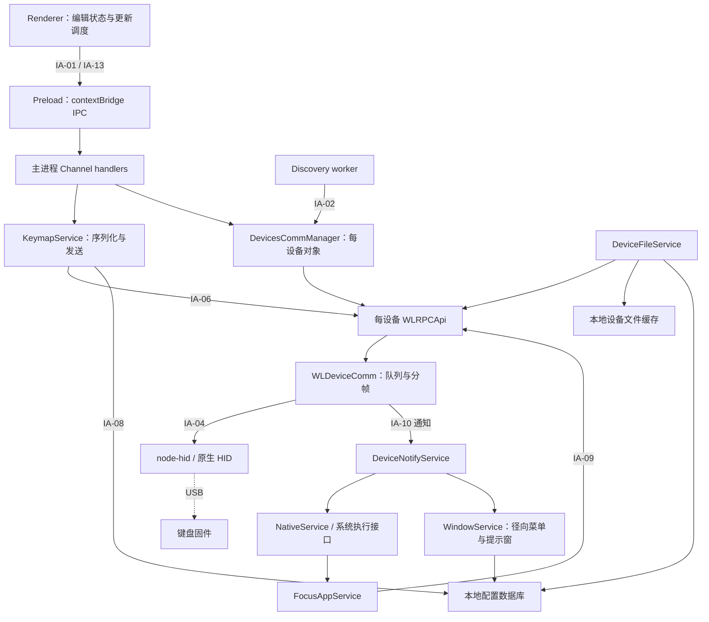
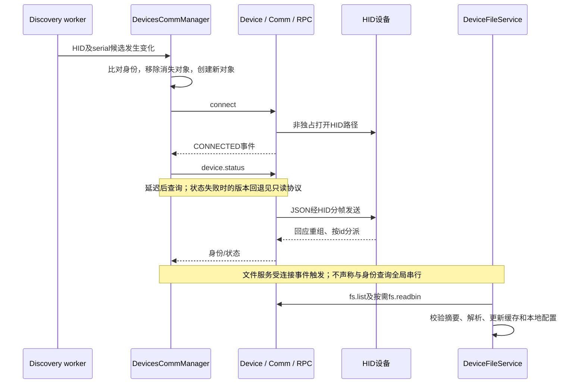
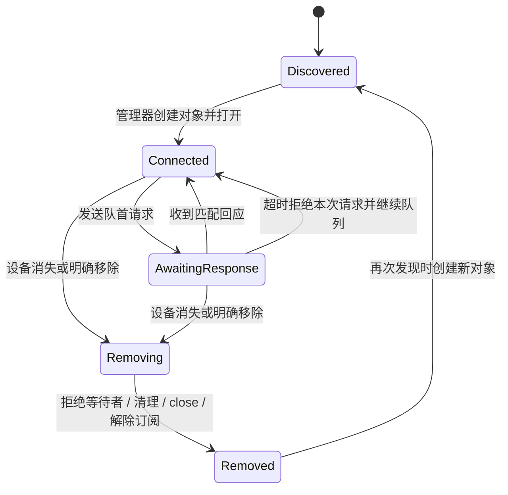
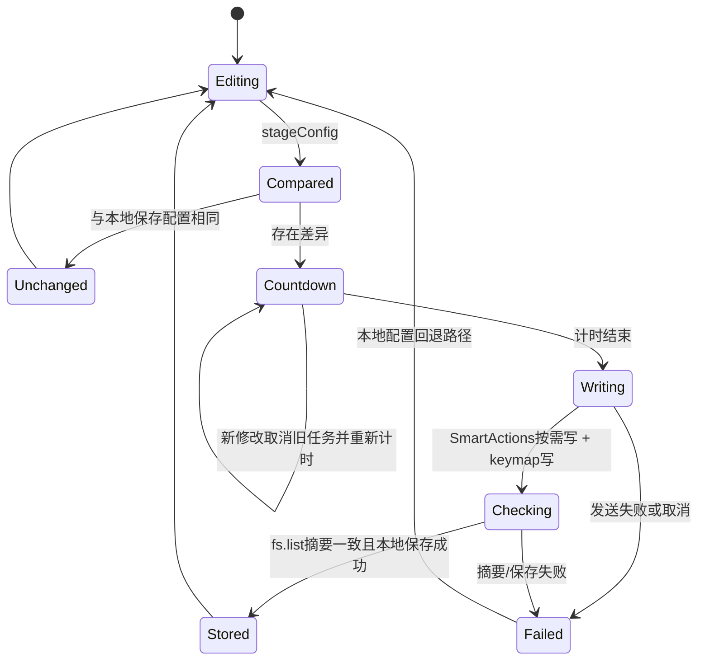
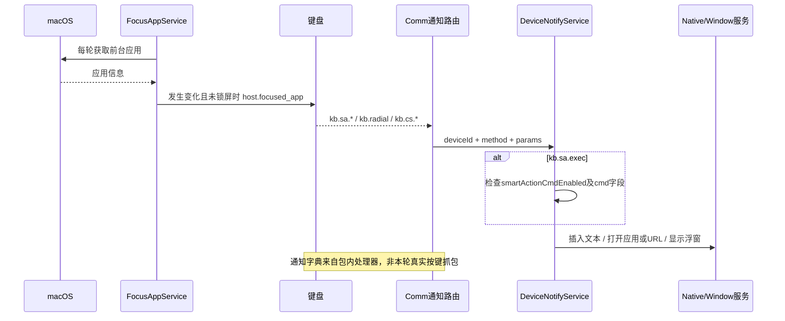

# Input 1.1.0 私有协议与业务架构

本轮结论：Input 是 Electron 界面、主进程设备服务、Work Louder SDK 和 macOS 能力的组合。配置下行以文件为单位；宿主功能上行以通知为单位。前台应用检测又形成一条宿主到设备的消息链。独立管理器必须分别处理配置、会话和宿主动作，不能把全部键盘功能视为一种宏执行器。

范围：本机 Input 1.1.0，Creator Micro 2 相关代码。以下为当前安装包的静态事实或明确标记的推断，不是本轮实机协议验收。没有启动、重启、注入 Input，没有读取个人配置、发送设备请求或改变映射。候选字段见[协议补充](protocol-candidates.md)，独立实现边界见[模块契约](module-contracts.md)。

## 证据身份与可复核位置

原始提取物、包体清单与辅助分析输出仅保留在未提交的本地私有工作目录，本页仅保留独立实现所需的组件职责与边界结论。

| 结论 ID | 子系统边界 | 支持的事实 |
| --- | --- | --- |
| IA-01 | Preload / 主进程 IPC 边界 | 枚举值定义 IPC 通道；配置调用先返回取消标识，最终结果另发事件 |
| IA-02 | 设备发现 Worker / Comm 管理器 | worker 合并扫描、监听变化，管理器为发现的设备创建连接对象 |
| IA-03 | 设备会话与 RPC 服务 | 每设备持有通信与 RPC 服务；Creator Micro V2 标记 radial/focusedApp 特性；连接后查询状态 |
| IA-04 | HID 分帧与队列调度 | 队列、HID 帧、换行重组、响应/通知分派、超时及任务间隔 |
| IA-05 | 设备文件与本地缓存层 | 文件列表、摘要比较、缓存与配置加载；缓存是单独的数据层 |
| IA-06 | Keymap 序列化与写后核验 | Smart Actions 按需先写、keymap 后写、list 摘要核验、保存本地配置 |
| IA-07 | 分块写入与队列取消边界 | 分块写参数；取消队列；另有事务 API，但普通配置发送链未调用它 |
| IA-08 | 本地持久化存储 | userData 下的 JSON 数据库与 devices 文件缓存 |
| IA-09 | 前台应用采样与上下文上报 | 前台应用检测、变化比较、host.focused_app；五次采样的应用选择辅助流程 |
| IA-10 | 宿主通知与系统执行边界 | 宿主通知，命令同意开关，文本/应用/URL 执行边界 |
| IA-11 | 轮盘与提示浮窗投影 | 径向菜单与 Cheat Sheet 使用设备通知及本地配置投影 |
| IA-12 | 宏与 Multi Action 序列化 | 宏、Multi Action、keymap 的设备序列化字段 |
| IA-13 | 渲染层编辑调度与回退 | 更新调度、去重比较、倒计时、发送与本地失败回退 |
| IA-14 | Profile 切换处理器 | Profile 选择处理器同时改变选择值和使用值，并选择第 0 层 |
| IA-15 | 配置解析与历史迁移边界 | 解析 keymap 可触发迁移写回；已读分支仅为 KnobF1/NomadEV2 提供迁移配置 |
| IA-16 | 断连清理与句柄回收 | 断连拒绝队列与等待者、清理状态、关闭句柄；管理器移除订阅及设备对象 |
| IA-17 | 两区灯光字段与预览调用边界 | 两区灯光字段、Layer 持久化及即时预览调用边界 |
| IA-18 | 灯光预览与缺失灯光默认值 | 预览按当前连接设备转发两区值；缺失灯光的默认值和初始化路径，详见候选协议 |

IA 定位由人工核对接口边界确认，不代表已验证全部运行时调用路径。

## 工具覆盖与局限

本架构说明基于 Creator Micro 2 业务接口边界的静态整理。IPC 通道使用枚举成员而非字面量分发，具体映射由人工对照 preload、主进程 handler 与设备 SDK 接口整理得到。

本轮静态检查未采集运行时调用轨迹，未对未签名或受争议原生插件作出可执行信任背书，也不以此证明独立工作目录可隔绝所有原生副作用。

## 1. 组件架构

图中实线为包内代码可确认的连接，虚线为外部行为边界，不能作为本轮固件执行证据。

启动服务在主进程初始化阶段统一装配。图保留与 Creator Micro 相关的边界；升级、图片转换和其他设备的媒体功能不表示 Creator Micro 全部支持。

## 2. 连接与读取

IA-02–05。Input 会自动连接发现的设备；不能把打开 Input 当作不接触硬件的纯浏览操作。身份键含设备 PID、序列号规范化值、连接类型、型号、布局和端口路径；不能直接把其临时对象 ID 当作跨重连身份。

通信层逐请求排队；单请求超时为 10 秒，任务结束后等待 50 ms 才处理下一项（IA-04）。这些是该客户端策略，不是已证明的固件强制参数。

断连生命周期可进一步恢复如下（IA-02、04、16）。注意原 SDK 的 `cleanOnDisconnect` 清除队列、resolver、rpcResponse 和句柄，但本段没有清除 `buffers[channel]`；不能从“清理”这个函数名推断所有分帧残留均清空。

该图不证明睡眠恢复、资源释放时序或旧回调竞争已在实机通过。

## 3. 编辑到设备配置的生命周期

IA-06、07、13、14。前端 `lV=3`，tick 将倒计时递减到 0 后在下一次 tick 执行发送；不能把常量 3 直接作为“精确 3 秒端到端更新延迟”。主界面 effect 在配置完成/layout 阶段调用 `stageConfig`，首次 effect 被跳过。

Profile 下拉选择处理器同时调用所选和所用 Profile 的 setter，并把层选择设为 0。因此已有“切换 Profile 名称也会触发更新”的观察有代码线索支持；这不是一次新的设备行为验收。

`changeDeviceConfig` 的 IPC Promise 首先返回 keymap 写入的取消 ID；发送结束另外发布 `connDeviceOnChangeDeviceConfig`。独立客户端必须区分“请求已受理”和“提交已验证”。

失败分支尝试回退的是前端本地配置记录。所读调用路径没有在这里重新把完整旧配置写回设备；不能称作硬件回滚。Smart Actions 写成功而 keymap 失败时，可能处在跨文件部分更新状态，这是从顺序推得的风险，未以实机制造故障验证。

## 4. 宿主事件与上下文

IA-09–11。前台应用检测循环在每次采集后延时约 1000 ms；变化按 `appName/process/path` 比较。与 UI 中的“切换应用后采集五次”是两个流程，不能把五秒当成后台自动切换阈值。主机上报上下文，固件如何依据 `linkedApps` 选择层仍需固件或实机证据。

普通宏序列和 Multi Action 四分支被编码进 keymap（IA-12）；宿主的 Smart Action 执行器只处理相应通知。由此可以区分“发送给设备的动作描述”与“由宿主实际执行的系统操作”，但不能仅凭代码证明所有普通宏都能脱离 Input 完整运行。

## 5. 业务覆盖与尚缺的连接

| 场景 | 本轮恢复的路径 | 缺口及下一项证据 |
| --- | --- | --- |
| Profile | 前端选择/使用状态 → stageConfig → keymap → 摘要验证 | 设备实际激活时刻、失败恢复；需受控读回 |
| Layer | Layer 对象 → layout/lights/linkedAppId → Profile 序列化 → keymap | UI 选择和固件活动层并非同一状态；切层规则需固件或实机 |
| 普通键 | layout.keymap 中的绑定 → keycode 转换 → 文件发送 | 矩阵扫描、去抖和 OS 输入报告在固件侧；需物理输入与报告对照 |
| 旋钮 | layout encoders 绑定 → 文件发送 | 顺逆方向、步进和按压对应关系需逐控件实测 |
| 普通宏 | actions 步骤 → kc/delay/act → macros → keymap | 设备实际计时和执行次序需验证，不能只读序列化器 |
| Multi Action | 四分支 keycode 与 tt → multiActions → keymap | 固件手势判定及边界时间需测试 |
| 持久灯光 | backlight/underglow → Layer.lights → keymap | effect/brightness/speed/magic/color 的值域及生效时刻未知 |
| 灯光预览 | RPC Channel → sendLightingPreview → lights.preview | 即时效果与非持久性目前仅 SDK 意图；恢复需实测 |
| AppSense | 原生前台采集 → 变化比较 → host.focused_app | 固件根据 linkedAppId 的匹配和切层行为未恢复 |
| 径向菜单 | kb.radial → 本地配置索引 → 浮窗显示/更新 | 最终动作触发边、字段值域及物理手势待补 |
| Cheat Sheet | kb.cs.* → 本地配置索引 → 浮窗 | 是否与当前设备配置一致需读回对照 |
| 宿主 Smart Action | kb.sa.* → 参数检查/命令许可 → 系统接口 | 实际通知产生条件、焦点和系统权限需运行时验证 |

普通键和旋钮的虚线边界是明确未恢复的固件行为，而不是省略的已知实现。两区灯光字段来自 IA-17；未从 UI 默认值推断固件参数范围。

## 尚未签收的部分

- 没有运行时 hook 或物理总线包，本轮无法确认任何新发现的写方法在固件 0.6.3 的行为。
- 没有解析固件内部状态机；BLE、原生模块内部、物理开关与键帽位置仍不在本轮证据覆盖内。
- 真正的按下/释放原始通知未由上述 `kb.sa.*` 字典证明，不能把宿主命令通知转换成物理键事件。
- 多宿主同 ID 冲突、取消时已写入的部分数据、断连后的设备恢复仍需独立实验。
- 全包映射覆盖为 partial；本文手工追通的是表中关键业务边界，不是所有程序路径。
